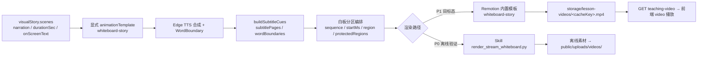

# SRT 白板手绘动画集成方案

> 版本: v0.1
> 日期: 2026-11-23
> 状态: 方案待评审
> 关联试跑: `.workbuddy/samples/whiteboard-demo/`（28 秒「形状王国」样例，已验收）
> 关联 Skill: `.workbuddy/skills/srt-whiteboard-animation/`（MIT，已提交 `9a565b7`）

---

## 1. 目标与结论

把 `srt-whiteboard-animation` 的「字幕叙事分区 + 连续笔迹落墨」能力引入灵犀伴学，用来**增加课程内容的表现维度**：现有 Watch 步骤主要靠 `word-reveal` / `story-scene` 做静态图文揭示，缺少「一个概念/动作如何一步步形成」的过程演示。白板手绘擅长把叙事拆成有序事件，让孩子跟着笔尖看形状、变化、关系和步骤，适合 3-6 岁认知特点。

**一句话结论：插在课程第 1 步 Watch（看/观察）最合适；美术课的 draw-intro 是明确次选；不要放进 practice / roleplay / experiment。**

产品化路径建议：**目标态做成 Remotion 原生模板**（无 Python 依赖、可自动出片、复用现有 TTS 时间轴）；**当前已装的 Skill 作为离线创作/效果验证工具**，不进后端运行时。

---

## 2. 它在课程的哪一步加入

课程固定四步由 `assembleLesson` 组装（`src/backend/src/modules/learning/lesson-content.service.ts:1334-1372`）：

| 步骤 | id | 领域决定 | 是否接入白板动画 | 说明 |
|---|---|---|---|---|
| 1. 看 | `watch` | 固定，`module.type = video` | **✅ 首选** | 原生消费 `visualStory.scenes`，已有 `narration` / `durationSec` / `animationTemplate` |
| 2. 读 | `read` | 固定，`module.type = reading` | ❌ | 文字/描红，白板源图禁止出现文字 |
| 3. 写/画/做/演 | 由 `getDomainStepPlan` 决定 | language·math→写，art→画，science→做，social→演 | **⚠️ 次选：仅 art 的 draw-intro** | 其余步骤是互动，不是观看 |
| 4. 练 | `practice` | 固定，`module.type = game` | ❌ | 需要真实交互，视频无法替代 |

### 2.1 为什么是 Watch

1. Watch 步骤直接由 `resolveWatchScene` 消费 `visualStory` + `videoLesson`（`lesson-content.service.ts:1321,1640-1656`），`deriveWatchSceneDocument` 逐字段读取 `narration`、`onScreenText`、`durationSec`、`animationTemplate`（`lesson-scene.ts:806-869`），白板动画所需输入已存在。
2. 模板选择保留了「显式 `animationTemplate` 优先」的钩子（`lesson-scene.ts:580-589`），新增模板 ID 即可切入，不必新增步骤或改数据结构。
3. Watch 已有 TTS + 逐字字幕时间轴（`subtitle-timing.ts:122-220`），可直接充当白板区的 `startMs` / `durationMs` 来源。

### 2.2 哪些镜头适合换成白板

按 `narrativeRole` 筛选，不按位置硬套：

| 镜头语义 | 例子 | 建议模板 |
|---|---|---|
| 场景铺垫 / 关键物体 | 「住着三个好朋友」 | `language.whiteboard-story` |
| 动作或变化 | 「圆形宝宝滚来滚去」 | `language.whiteboard-story` |
| 关系 / 数量 / 图形 | 形状、数数、昼夜、水的循环 | `math.whiteboard-explain` / `science.whiteboard-process`（P3） |
| 绘画示范引入 | 美术课 `draw-intro`（`lesson-scene.ts:1222-1231`） | `art.whiteboard-demo`（P3） |
| 字词识读、描红 | 识字、笔画 | 保持 `language.word-reveal` / `language.character-stroke` |
| 互动练习、角色扮演、实验操作 | practice / roleplay / experiment | 保持原样 |

**内容侧规则**：课程 JSON 只有在 `scene.animationTemplate` 显式写白板模板时才走白板；未写的镜头继续走现有启发式推断。这样是「丰富」而不是「替换」，也不会让所有课突然变成同一种画风。

---

## 3. 数据流与架构



### 3.1 时间轴必须单一来源

这是最容易出错的地方。Skill 的 SRT 和项目已有的 `subtitlePages` 是两套时间源，**同一幕不能混用**。

- 项目已有链路：`voice.service.ts:83-145` 取 Edge TTS WordBoundary → `subtitle-timing.ts:122-220` 产出逐字 `subtitlePages` → `remotion-render.service.ts:1845-1859` 注入 `scene.subtitlePages`。覆盖率 <60% 时整条回退「按字数估算」，不做部分下发。
- 接入方案：**白板区的 `startMs` / `durationMs` 从 `subtitlePages` 派生**（一屏字幕对应一个绘制区域），不落 SRT 文件。
- 若必须吃外部 SRT（例如老师手写旁白），新增 `buildSrtFromSubtitleCues()` 适配函数，把 `subtitlePages` 合成标准 SRT 再交给 Skill；此时 `sceneDurationMs = endMs - startMs`（试跑实测：字幕尾 28.5s、首 0.5s，脚本给出 28000ms）。
- Skill 建议 25–35 秒/幕是创作建议，不是硬约束。项目镜头常见 8–12 秒（`durationSec` 安全范围 3–120，`lesson-scene.ts:831`）：短镜头做 1–2 个区域，或把相邻短镜头合并成一幕 ≤30 秒。

### 3.2 白板分区数据契约

在 `animationParams` 下新增 `whiteboard` 对象，与 Skill 的 `annotation.json` 同构，便于离线渲染器直接复用：

```json
{
  "scene": "形状朋友们",
  "narration": "圆形宝宝滚来滚去，我是圆形，像球一样。",
  "durationSec": 11,
  "animationTemplate": "language.whiteboard-story",
  "animationParams": {
    "whiteboard": {
      "paper": "#F6F1E3",
      "inkPath": "grid",
      "colorFill": "contour-wipe",
      "canvas": { "width": 1536, "height": 864 },
      "regions": [
        {
          "id": "circle",
          "label": "圆形宝宝",
          "sequence": 1,
          "narrativeRole": "关键物体",
          "subtitle": "圆形宝宝滚来滚去，我是圆形，像球一样。",
          "region": { "x": 220, "y": 250, "width": 280, "height": 210 },
          "startMs": 5000,
          "durationMs": 6500,
          "protectedRegions": []
        }
      ]
    }
  }
}
```

约束：
- `sequence` 从 1 连续，按字幕叙事顺序，不按从左到右/从上到下。
- `region` 用原图整数像素，原点左上；`canvas` 必须等于源图像素尺寸。
- 重叠主体在先画区域的 `protectedRegions` 里标出，避免后续内容提前露线。
- 同一幕区域**时间串行**，下一区域从上一区域结束 +100~300ms 开始。
- 全部画完后凝视至少 0.5 秒完整画面。
- 源图禁止任何文字/数字/标签；要显示的词句继续用现有字幕层叠加。

---

## 4. 两条接入路径

### 路径 A：离线 Skill 生产素材（已验证，立即可用）

把白板 MP4 作为预处理素材生成好，放到 `public/uploads/videos/`，课程内容通过 URL 引用。

- 优点：零后端改动；可人工审片；适合示范课、公开课、少量精品课。
- 缺点：不能随课程 JSON 自动生成；7 个确认关卡；服务器不装 Python 环境。
- 适用：P0 效果验证、美术/古诗等精制作场景。

### 路径 B：Remotion 原生模板（推荐目标态）

把「分区揭示 + ink→color」实现成 `ANIMATION_TEMPLATES` 里的内置模板，走现有 `remotion-render.service.ts` 渲染。

- 优点：复用 TTS 时间轴、引擎回退链、缓存、审批和前端播放器；无 Python 依赖；可批量自动出片。
- 缺点：要写 Remotion 组件与编排代码，改动面比 A 大。
- 适用：P1 起的主线方案。

### 路径 C：把 Skill 接入后端 Agent 框架（可选，不建议先做）

`skill-registry` 只认 `SKILL.md` frontmatter（`markdown-skill-loader.ts:56-85`）。当前 Skill 只有 `name`/`description`，能加载但不会被自动触发。若要接入需补：

```yaml
id: srt-whiteboard-animation
triggers: [白板动画, 手绘讲解, whiteboard]
variables:
  - { name: scene, type: string, required: true, description: 镜头 JSON }
  - { name: ageGroup, type: string, required: false, defaultValue: "3-4" }
requiredTools: [renderWhiteboardVideo]
ageGroups: ["3-4", "5-6"]
chainTo: activity-validation
```

还要注册 Python 调用工具并加入 `course-designer.agent.ts` 的 `allowedSkills`。因为存在人工确认关卡和跨进程依赖，**不建议作为自动出课主链路**，仅作为创作侧辅助。

---

## 5. 落地计划

### P0 — 效果验证（已完成）

- 安装 Skill 到 `.workbuddy/skills/srt-whiteboard-animation/`，建好隔离 `.venv`。
- 用「形状王国」旁白产出 28 秒 SRT + 线稿 + 三区域标注 + 成片，关键帧验收通过。
- 产物路径见附录 A。

### P1 — 模板入口与 Watch 分支

1. 在 `animation-templates.ts:16` 的 `ANIMATION_TEMPLATES` 增加 `language.whiteboard-story`。`KNOWN_TEMPLATE_IDS`（同文件 404 行）会自动纳入白名单，`generate-course-pack.ts:1088-1108` 的校验无需另改。
2. 在 `inferWatchTemplateHint`（`lesson-scene.ts:559-782`）增加显式分支：当 `scene.animationTemplate === 'language.whiteboard-story'` 时原样返回，并把 `animationParams.whiteboard` 透传进 `templateParams`。
3. 在 `remotion-render.service.ts` 的 `buildWatchSlides`（602-646）/`prepareGeneratedPropsWithAudio`（1806-1973）增加白板渲染分支：读取 `whiteboard.regions`，用 `subtitlePages` 对齐 `startMs`，用现有 TTS 音频做旁白。
4. 保持 `steps[].id`、`module.type`、`type`、`version` 不变（`lesson-content.service.ts:1002` 明确禁止修改，否则前端渲染和增量合并会失效）。

### P2 — 引擎与缓存

1. 在 `lesson-video-queue.service.ts:885-990` 的 `engineOrder` 增加白板分支；返回非空 buffer，否则会被回退链跳过。
2. 复用 `writeVideoToCache`（1740-1760）的缓存与兼容转码；缓存 key 需包含模板 ID 与 `whiteboard.regions` 哈希，避免不同分区配置命中同一视频。
3. 学生端播放受 `approvalStatus === 'approved'` 限制（`learning.controller.ts:599-602`）；自动生成需配置 `autoApprove`，或走家长确认。
4. 检查 `buildWatchSlides`（`remotion-render.service.ts:616-641`）的「整课模板参数相同则重派生」逻辑：白板课的每幕 `templateParams` 必须不同，否则会被覆盖。

### P3 — 丰富度扩展

1. 按领域拆模板：`math.whiteboard-explain`、`science.whiteboard-process`、`art.whiteboard-demo`。
2. 美术课把 `draw-intro`（`lesson-scene.ts:1222-1231`）的静态讲解图换成白板示范，孩子再进入 `free_draw`。
3. 给 Skill 脚本打补丁暴露 `--match-bg-threshold`（见风险 R1），让离线路径也稳定。
4. 可选：按路径 C 接入 Agent 框架，用于人工创作精品课。

---

## 6. 关键坑与风险

| 编号 | 风险 | 证据 | 规避 |
|---|---|---|---|
| R1 | 背景纹理导致结尾帧斑驳 | Skill 的 `match_bg_threshold=28` 写死且未暴露 CLI（`stream_render.py:73`、`render_stream_whiteboard.py:128`） | 渲染前把背景压平为 `#F6F1E3`：用 `diff<90` 掩膜替换，线条与彩色点缀保留；P3 给脚本加参数 |
| R2 | 双字幕时间源 | `subtitlePages` 有覆盖率回退机制（`subtitle-timing.ts:187`） | 同一幕只用一种口径；优先 WordBoundary 派生，回退时整条回退 |
| R3 | agent 自写 TSX 被丢弃 | `video-generation-agent.service.ts:259-267` | 白板必须走内置模板/独立引擎 |
| R4 | 模板参数被重派生覆盖 | `remotion-render.service.ts:616-641` | 每幕 `templateParams` 差异化 |
| R5 | 生成图水印与笔杆品牌字 | 试跑发现 ImageGen 右下角水印；`drawing-hand.png` 笔杆有作者标识 | 出图后裁补右下角；纯净画面用 `--bare-tip` |
| R6 | 步骤结构被改导致前端异常 | `lesson-content.service.ts:1002` | 只加模板与渲染分支，不改步骤 ID / 模块类型 / 版本号 |
| R7 | 白板图禁止文字 vs 识字课需求 | Skill 视觉规范 | 源图无字，词句用现有字幕层叠加；识字镜头继续用 `word-reveal` |
| R8 | Python 依赖进生产环境 | Skill 自建 `.venv` | 目标态走 Remotion，Skill 只驻留创作侧 |

---

## 7. 验收清单

- [ ] 首帧是干净的暖米黄纸底，没有提前露出的线条
- [ ] `canvas` 与源图像素尺寸一致，所有 `region` 为画布内整数像素
- [ ] `sequence` / `startMs` 与字幕叙事顺序一致，重叠主体有 `protectedRegions`
- [ ] 开场、重叠中段、结尾三个时间点：未绘制模块不可见，末帧是完整原图
- [ ] 每幕画完后凝视 ≥0.5 秒；多幕合并顺序与字幕一致
- [ ] 字幕与笔迹同步误差 <0.3 秒（沿用 `subtitle-timing.ts` 的验收口径）
- [ ] 视频经缓存 + 审批后可播放，前端 Range 请求正常
- [ ] 不改动 `steps[].id` / `module.type` / `type` / `version`
- [ ] 无 Python 依赖进入生产渲染链路

---

## 8. 参考资料（关键代码位置）

| 主题 | 文件:行号 |
|---|---|
| 课程四步组装 | `src/backend/src/modules/learning/lesson-content.service.ts:1334-1372` |
| Watch 场景消费 visualStory | `src/backend/src/modules/learning/lesson-scene.ts:806-869` |
| 模板显式优先 / 启发式 | `src/backend/src/modules/learning/lesson-scene.ts:559-782` |
| 模板白名单 | `src/backend/src/animations/animation-templates.ts:16,404` |
| 模板校验 | `src/backend/src/modules/ai/agent/tools/generate-course-pack.ts:1088-1108` |
| 领域步骤映射 | `src/backend/src/modules/learning/domain-step-plan.ts:10-31` |
| TTS WordBoundary | `src/backend/src/modules/voice/voice.service.ts:83-145` |
| 字幕时间轴 | `src/backend/src/modules/learning/subtitle-timing.ts:122-220` |
| 渲染 props 注入 | `src/backend/src/modules/learning/remotion-render.service.ts:1806-1973` |
| 引擎回退与缓存 | `src/backend/src/modules/learning/lesson-video-queue.service.ts:885-990,1740-1760` |
| 播放与审批 | `src/backend/src/modules/learning/learning.controller.ts:572-657,599-602` |
| Skill 加载规则 | `src/backend/src/agent-framework/skills/markdown-skill-loader.ts:56-85` |

---

## 附录 A：已验证样例

- 输入字幕：`.workbuddy/samples/whiteboard-demo/shapes.srt`
- 线稿与标注：`.workbuddy/samples/whiteboard-demo/assets/whiteboard/shapes/scene-01-shapes-flat.png`、`scene-01-shapes.annotation.json`
- 成片：`scene-01-shapes-whiteboard.mp4`（1080×600 / 60fps / 28s / 0.93MB）
- 验收拼图：`scene-01-shapes-frames.png`（0.2s / 8s / 15s / 22s / 27.9s）

复现命令：

```bash
SK=.workbuddy/skills/srt-whiteboard-animation
SC=.workbuddy/samples/whiteboard-demo/assets/whiteboard/shapes
ENV_PY="$SK/.venv/Scripts/python.exe"

python "$SK/scripts/parse_srt.py" .workbuddy/samples/whiteboard-demo/shapes.srt --target-sec 30 --min-sec 25 --max-sec 35
"$ENV_PY" "$SK/scripts/render_stream_whiteboard.py" "$SC/scene-01-shapes-flat.png" "$SC/scene-01-shapes.annotation.json" "$SC/scene-01-shapes-whiteboard.mp4" "$SK/assets/drawing-hand.png" --ink-path grid --color-fill contour-wipe
```
