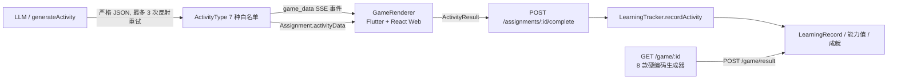
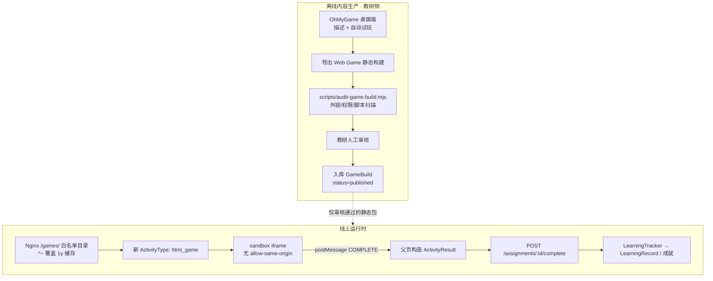

# OhMyGame 集成调研与实施方案 — 灵犀伴学

> **文档版本**: v1.8
> **创建日期**: 2026-11-10
> **更新日期**: 2026-11-10（P0 见附录 D；P1：drag_sort 见附录 E、memory_flip 见附录 F、pattern_next 见附录 G、设计评审见附录 H、trace_path 见附录 I、color_fill 见附录 J、tap_target 见附录 K）
> **状态**: 待评审（调研结论 + 实施设计；P0 隔离 PoC 已验证；**P1 方案 B 全部 6 种新题型（drag_sort + memory_flip + pattern_next + trace_path + color_fill + tap_target）已落地：双端链路 + 单测 + 双端构建/测试通过**）
> **调研对象**: [WhiteTowerAI/ohmygame](https://github.com/WhiteTowerAI/ohmygame) — <https://ohmygame.ai/>
> **核查基准**: 仓库 `main` 分支 `beta.5.5`（2026-11-06），API 快照 `pushed_at=2026-11-09`

---

## 0. 结论摘要

| 问题 | 结论 |
| --- | --- |
| 能否"引入这个开源项目"来丰富游戏化学习交互？ | **能借，但不是引入依赖**。它是 Electron 桌面创作工具，不是可被 NestJS 调用的服务端 SDK。 |
| 能否让孩子在对话里实时生成一款游戏？ | **不能，也不建议**。它没有 `generate_game` / build / export 接口，也没有 headless/服务器模式；且任意 LLM 生成的网页代码进入 3-6 岁儿童端不可接受。 |
| 值得引入的是什么？ | ① **离线内容工厂**：教研端批量生成 → 人工审核 → 静态构建产物入库；② **设计思路**：AI 自动试玩校验、素材生成供给。 |
| 最优先做什么？ | **方案 B：扩展自有题型 schema + 参数化游戏引擎**（AI 只产参数 JSON，引擎固定）。改动面最小、复用全部学习闭环、零新增信任面。 |
| 建议的技术路线 | 先 B（近期）→ 再 A（验证价值后）→ **C（线上实时生成）明确否决**。 |
| 现有基础设施是否就绪？ | **否**。无 iframe/WebView 运行时、无 CSP/沙箱、无第三方静态目录、静态资源被 `expires 1y` 强缓存、生产 nginx 配置不在版本库。 |
| P0 最小链路是否已验证？ | **是**。`poc/game-bridge/` 隔离 PoC 已跑通 31 项自动化检查（含真实 headless Chromium 的 sandbox iframe 闭环），不改任何生产代码。详见附录 D。 |
| P1 第一种参数化题型是否已落地？ | **是（drag_sort）**。后端参数契约/清洗/确定性试玩 + 两套生成工具 + 8 处白名单同步，Web/Flutter 双端渲染，16 项契约单测 + 双端构建通过。剩余 5 种题型待后续迭代，见附录 E。 |
| P1 第二种参数化题型是否已落地？ | **是（memory_flip）**。同一模式复用：后端契约（对数限定 2/3/4/6/8，grid 必须装下 pairs*2 张卡）+ 双端翻牌组件 + `pairs + gridSize → memory_flip` 推断优先于 `pairs → matching`，见附录 F。 |
| P1 第三种参数化题型是否已落地？ | **是（pattern_next）**。同一模式复用：后端契约（sequence 2-8 项 + options 2-4 项 + answerIndex）+ 双端规律推理组件 + `sequence + options → pattern_next` 推断，见附录 G。 |

**一句话决策**：把 ohmygame 放在**离线生产侧**，把"审核过的静态产物"作为唯一可跨越信任边界的东西；运行时继续坚持"AI 只产数据、引擎固定"。

---

## 一、调研对象事实核查

### 1.1 项目档案

| 项 | 值 | 来源 |
| --- | --- | --- |
| 定位 | 开源 AI 游戏创作工作室 / "一人游戏工作室"，带 Canvas 的桌面 GUI | README |
| License | Apache-2.0；**名称与 Logo 不在授权范围内** | LICENSE 说明 |
| 主语言 / 运行时 | TypeScript；工具链 Bun ≥ 1.4.2，daemon Node.js ≥ 22.19 | README / API |
| 形态 | Electron 桌面 app + 本地 daemon + Vite renderer；macOS(Apple silicon) / Windows(x64) 安装包 | README |
| 活跃度 | 1,837 stars / 230 forks / 1,738 commits；`created_at=2026-08-11`；最新版本 `v0.0.0-beta.5.5` | GitHub API |
| 成熟度 | **Beta**，README 明示 "Expect rough edges"；建库约 3 个月 | README |

### 1.2 生成能力与产物

- **输入**：自然语言描述 / 空白项目 / 导入已有目录；Canvas 节点可互相引用；BYOK 接 40+ 模型提供方。
- **流程**：起草设计文档 → 生成素材（图片/视频/3D/音频）→ 写代码 → `live preview` 运行 → `game_use` 自动试玩 → 发现问题自动修复重玩 → 发布。
- **产物**：**普通多文件 Web 项目**（Three.js / React Three Fiber / Phaser），或互动故事（每个 screen 是自由网页，node graph + runtime 管理状态/存档/音乐）。**不是单个 HTML 文件**。
- **发布**：`Sign in and publish` 生成 shareable link，README 明确 "uploads only your game's static build"；支持自行上传 Web Game build 到 itch.io / Poki / CrazyGames，说明**静态构建产物可自行托管**。

### 1.3 集成接口逐项核查（决定性结论）

| 能力 | 是否支持 | 证据 |
| --- | --- | --- |
| 作为 npm 包 / 库嵌入第三方应用 | ❌ | 无 SDK 声明；形态是桌面 app |
| 传统 REST API / OpenAPI | ❌ | 文档与 README 均未声明 |
| **headless / 服务器模式** | ❌ | `docs/external-agents.md` 依赖 Electron executable（`ELECTRON_RUN_AS_NODE=1`）、stdio launcher、每次启动变端口/token 的 private HTTP daemon；明确把 **"A user-configured HTTP entry" 列为 not in scope** |
| MCP Server | ✅ 但仅本机 | `ohmygame-studio`，stdio + `POST /external-mcp`；`claude mcp add` / `codex mcp add`；面向 coding agent，不是线上服务 |
| **通过 API 触发"生成一个游戏"** | ❌ | 公开 20 个工具：`list_projects` `open_project` `get_project` `get_job` `wait_job` `cancel_job` `generate_image` `generate_video` `generate_3d_asset` `animate_3d_asset` `generate_speech` `generate_sound_effect` `generate_music` `generate_audio` `canvas_check` `canvas_initialize` `generate_canvas_media` `game_use` `playable_add_node` `playable_check`。**无 `generate_game` / build / export / static build** |
| 把任务委托给它自己的 Agent | ❌ | `external-agents.md` Not in scope 原文："It nests two agent loops, hides progress, and bills two models for one task."；并写明 "the external agent plans and writes the code" |
| iframe / embed SDK / postMessage API | ❌ | README 与 `docs/README.md` 索引中 **无 embed / iframe / static build / headless 条目**；仓库内 `web-game-host.html` 属内部宿主页 |
| 插件扩展 | ✅ | Plugin API 2.3.0、`@ohmygame/plugin-cli`、`gameUse` manifest、`PluginGameRuntime`、Godot/Unity/Cocos/微信小游戏插件 |
| 素材生成能力外供 | ✅ | MCP 的 `generate_image` / `generate_speech` / `generate_music` 等，可由内容团队在本机调用 |

> **关键推论**：NestJS 后端**无法**通过 HTTP 调用 ohmygame 让孩子"说一句话生成游戏"。想做到必须 fork 它的 daemon、剥离 Electron、自建构建与发布流水线——成本远超收益，且把不可信代码引入儿童端（方案 C，否决）。

### 1.4 其它需要注意的条款

- **隐私/遥测**：正式版默认检查更新、发送使用数据（PostHog）与崩溃报告，可在 Settings → About 关闭；**从源码构建不发遥测**。若产物中残留第三方 CDN / 字体 / 统计脚本，需在入库审核时全部剔除。
- **密钥**：BYOK，密钥留在本地 daemon，不进入游戏产物——这一点对本项目是加分项。
- **商标**：Apache-2.0 允许商用与修改，但不得使用 "OhMyGame" 名称与 Logo 做对外宣传。

---

## 二、本项目现状盘点（代码级）

### 2.1 现有内容链路



**这条链路最重要的性质**：AI 只输出结构化数据，渲染引擎是项目自己写的固定组件。因此内容可审核、结果可埋点、分数可复算、适龄性可控。这是 3-6 岁产品的**资产，不是技术债**。

### 2.2 关键文件清单

| 文件 | 职责 | 与本案关系 |
| --- | --- | --- |
| `src/backend/src/agent-framework/tools/impl/generate-activity.ts` | `ActivityType` 定义、`SUPPORTED_TYPES`、`inputSchema.enum`、最多 3 次失败反射重试 | 方案 B 主改点 |
| `src/backend/src/agent-framework/core/types/stream-events.ts:46` | `GameDataEvent { type:'game_data', activityType, gameData:string, domain? }` | 方案 B 需保持兼容 |
| `src/backend/src/modules/game/game.service.ts` | 8 款硬编码游戏生成器；`saveGameResult`；`resolveContentId`；`getGameDomain` | 方案 A 回写路径需修改 |
| `src/backend/src/modules/game/game.controller.ts` | `GET /game/list`、`GET /game/:gameId`、`POST /game/result`、`GET /game/level/:userId` | 方案 A 复用 |
| `src/backend/src/modules/assignment/assignment.service.ts:324` | `complete()` → `status/score/resultData` → `learningTracker.recordActivity('assignment_completion')` | **首选回写入口** |
| `src/backend/src/modules/assignment/assignment.controller.ts:115` | `POST /:id/complete`，仅 child 角色且校验 `childId` 归属 | 权限基线 |
| `src/backend/src/agent-framework/tools/impl/record-learning.ts:55` | `recordLearning` → `interactive_activity` → 成就 | 自由玩场景备选 |
| `src/backend/src/database/entities/learning-record.entity.ts` | `learning_records` 表结构 | 无需改动 |
| `src/backend/src/app.module.ts:85` | TypeORM `entities: [__dirname + '/**/*.entity{.ts,.js}']`，三个连接；`migrationsRun=!synchronize` | **新增实体必须写 migration** |
| `src/frontend-web/src/types/index.ts:221` | `ActivityType` / `ActivityData` / `ActivityResult` / `Assignment` | 方案 A/B 均需扩展 |
| `src/frontend-web/src/components/games/GameRenderer.tsx` | 7 个 `case` 分发 + `default` 显示"暂不支持的活动类型" | 新增分发分支 |
| `src/frontend-web/src/components/ai-chat/activity-normalizer.ts:22` | `normalizeActivityType` / `isActivityType` 白名单与结构推断 | **易漏改点** |
| `src/frontend-web/src/App.tsx:156` | `GameRenderer onComplete` → `api.completeAssignment` | 回写链路 |
| `src/frontend-web/src/services/api.ts:624` | `completeAssignment(id, result)` → `POST /assignments/:id/complete { score, resultData }` | 只传 score 与 resultData |
| `src/frontend/lib/screens/games/game_renderer.dart:91` | `_normalizeGameType` 7 种白名单 + 按数据结构推断 | Flutter 侧易漏改点 |
| `src/frontend/lib/services/api_service.dart:887` | `getGameList` / `getGameData` / `saveGameResult` | Flutter 侧 API |
| `src/frontend-web/nginx.conf` | Docker 内 React Web 的 nginx 配置 | 方案 A 托管主改点 |
| `docker-compose.prod.yml` | frontend 无静态卷，backend 仅 `backend-data:/app/data` | **需新增静态卷** |
| `docs/bento-integration-plan.md:300,332` | 历史决策："WebView 内嵌会导致 UI 冲突和体验割裂"→ 改新标签页；"无需 webview_flutter 和 iframe 依赖" | 必须先解释为何本案不同 |

### 2.3 现有数据契约（真实定义）

```ts
// src/frontend-web/src/types/index.ts:221
type ActivityType = 'quiz' | 'true_false' | 'fill_blank' | 'matching'
                  | 'connection' | 'sequencing' | 'puzzle';

interface ActivityData { type: ActivityType; title: string; [key: string]: any }

interface ActivityResult {
  score: number;
  totalQuestions: number;
  correctAnswers: number;
  timeSpent?: number;
  interactionData: { reviewData?: Array<{...}>; [key: string]: any };
}

// src/backend/src/modules/game/game.service.ts:7
interface GameResult {
  gameId: string; score: number; timeSpent: number;
  correctAnswers: number; totalQuestions: number;
}
```

### 2.4 两条回写路径的语义差异（重要）

| 路径 | 入口 | 服务端行为 | 注意点 |
| --- | --- | --- | --- |
| 作业完成 | `POST /api/assignments/:id/complete` | `Assignment.status='completed'`、`score`、`resultData`，随后 `LearningTracker.recordActivity` | 前端只传 `{ score, resultData }`，**不传 timeSpent / correctAnswers**；权限校验严格（仅本人 child） |
| 自由游戏 | `POST /api/game/result` | `GameService.saveGameResult` 写 `LearningRecord` | **会重算 `score = round(correctAnswers / totalQuestions * 100)`，忽略传入 score**；`status` 由 `correctAnswers >= totalQuestions/2` 决定；`resolveContentId(gameId)` 走 `getGameDomain` 映射表，未命中 **fallback 到 contentId=1** |

> **坑 1**：方案 A 的 postMessage 若只回传 `score`，走 `/game/result` 会被后端覆盖。协议必须携带 `correctAnswers` / `totalQuestions`，且分数定义与后端保持一致。
> **坑 2**：新增的游戏 build 不在 `getGameDomain` 的 8 条映射里，`resolveContentId` 会静默把内容归到 `contentId=1`，导致学习报告领域统计错误。方案 A 必须扩展 `resolveContentId`，让它优先查 `GameBuild.contentId`。

### 2.5 部署与基础设施约束

| 约束 | 现状 | 影响 |
| --- | --- | --- |
| nginx 缓存 | `nginx.conf:16` 对 `\.(js\|css\|png\|...)$` 设置 `expires 1y; Cache-Control: public, immutable` | 游戏静态资源若放进默认匹配范围将**无法更新**；必须用 `location ^~ /games/` 覆盖（前缀 `^~` 优先于正则） |
|  framing | `nginx.conf:41` `X-Frame-Options "SAMEORIGIN" always` | 同源 iframe 允许；跨源嵌入禁止。两个生产域名各自都要能访问 `/games/` |
| CSP | 无 `Content-Security-Policy`、无 `frame-ancestors`、后端无 helmet | 需新增，且注意 nginx 的 `add_header` 在 location 内会**覆盖** server 级声明，需重新列全 |
| 静态卷 | `docker-compose.prod.yml` 的 frontend 镜像只读、无挂载卷 | 需新增 `games-data` 卷或宿主机 bind mount |
| 后端静态目录 | `main.ts:34` `useStaticAssets(public/, prefix '/')`；AGENTS.md 注明 `backend/public/` 只放 `uploads/` | 若把游戏放 backend，需新增目录与路由，且与 SPA fallback（`:51`）冲突要处理 |
| CORS | `main.ts:66` `CORS_ORIGINS` 白名单 + `credentials:true` | 游戏产物**不应**直接调用 `/api`，避免放宽白名单 |
| 生产 nginx | AGENTS.md 描述宿主机 `/etc/nginx/sites-available/lingxi`（:80 Flutter Web、:8081 React Web），**该配置不在版本库**（`deploy/` 仅有 `.env.example`） | 存在两套部署拓扑，改动必须同步；建议把 nginx 模板纳入 `deploy/nginx/` 管理 |
| 数据库 schema | `app.module.ts` 走 `resolveSynchronize`，生产为 migration 模式 | 新增实体必须提供 migration，不能依赖 `synchronize` |

### 2.6 能力缺口编号（后续方案对应）

| ID | 缺口 |
| --- | --- |
| G1 | 交互形态锁死在 7 种固定题型，`ActivityType` 是前后端三处硬编码白名单 |
| G2 | 无让 LLM 产出可运行前端代码的机制；HTML 仅用于视频/报告中间产物 |
| G3 | 无 iframe / WebView 运行时；历史决策明确弃用 WebView 内嵌 |
| G4 | 无第三方静态游戏目录、无 CSP/沙箱、无内容审核入库表 |
| G5 | `game` 模块与积分/成就不直连，仅靠 `LearningTracker` 间接触发 |
| G6 | 两个 HTML 单文件原型（`kids-brain-training/index.html`、`kids-points-app/index.html`）完全未被引用，属沉没资产 |

---

## 三、目标、非目标与红线

### 3.1 目标

1. 在**不改变现有信任模型**的前提下，把可玩交互形态从 7 种扩到十余种。
2. 建立一条"外部 AI 生成内容 → 人工审核 → 版本化入库 → 受控投放 → 回写学习记录"的可复用管线。
3. 所有新玩法都能进入既有 `LearningRecord` / 能力值 / 成就 / 家长报告闭环。
4. 验证 ohmygame 生成的游戏对 3-6 岁儿童是否**真的**比参数化题型更有学习效果，用数据决定是否继续投入。

### 3.2 非目标

- ❌ 让孩子端对话直接触发 LLM 编写游戏代码。
- ❌ 把 ohmygame 编辑器 / Canvas 嵌入家长端或儿童端。
- ❌ 在服务器上运行 ohmygame daemon 做实时生成。
- ❌ Phase 1 支持 Flutter **原生 App**（Android/iOS）内的游戏 WebView。
- ❌ 引入广告、内购、社区排行、账号体系。

### 3.3 红线（R）

| ID | 红线 |
| --- | --- |
| R1 | 只有 `status=published` 且通过自动化扫描 + 人工审核的静态包可上线 |
| R2 | 游戏产物不得发起任何跨域网络请求、不得读写 cookie / localStorage / 儿童数据、不得请求摄像头麦克风 |
| R3 | iframe 必须 `sandbox`，**禁止** `allow-same-origin` / `allow-top-navigation` / `allow-popups` / `allow-forms` |
| R4 | 游戏只能通过 `postMessage` 上报结果，**不得**直接调用 `/api/*`；不得向游戏内传 JWT |
| R5 | 3-6 岁内容必须无阅读门槛、无外部账号、无广告、无未审核文案与图片 |
| R6 | 任何新玩法都必须产生 `LearningRecord`；无记录的"纯玩"不上线 |

---

## 四、方案比选与决策

### 4.1 方案定义

| 方案 | 做法 | 是否引入 ohmygame 运行时 |
| --- | --- | --- |
| **B** | 扩展自有 `ActivityType` 与参数化游戏引擎，AI 只填参数 JSON；借鉴 ohmygame 的"生成 → 自动试玩校验"思路做 JSON 状态机模拟 | 否 |
| **A** | ohmygame 作为**离线内容工厂**：教研端生成并试玩 → 人工审核 → 静态构建产物入库 → 白名单目录 + 新 `html_game` 类型 + sandbox iframe 投放 | 否（只用其产物） |
| **C** | 线上实时生成：fork daemon、剥离 Electron、服务端构建并即时投放 | 是 |

### 4.2 评分矩阵（5 分制，加权）

| 维度 | 权重 | B | A | C |
| --- | --- | --- | --- | --- |
| 交互丰富度提升 | 25% | 3 | 5 | 5 |
| 内容安全可控性 | 25% | 5 | 4 | 1 |
| 学习闭环完整性 | 20% | 5 | 4 | 2 |
| 工程改动量（分高=改动小） | 15% | 4 | 2 | 1 |
| 部署/运维复杂度（分高=简单） | 10% | 5 | 3 | 1 |
| 外部依赖风险 | 5% | 5 | 3 | 1 |
| **加权总分** | 100% | **4.20** | **4.00** | **2.30** |

> B 与 A 分数接近但性质不同：B 是**低风险、可立即开工**的基础能力；A 是**高上限、需要先补基础设施**的内容管线。二者不是二选一，而是串行关系。

### 4.3 决策记录（ADR）

- **采纳 B 为 P1**：先解决 G1，投入最小且复用全部闭环。若做完 B 后"丰富度"已达标，A 可以不做。
- **采纳 A 为 P2，且以 PoC 作为准入门槛**：只有 PoC 证明 AI 生成游戏在学习效果/留存上显著优于参数化题型，才继续投入基础设施。
- **否决 C**：无服务端 API、需 fork 整个桌面 daemon、任意代码进入儿童端、绕过所有审核，违反 R1~R5。记录在此避免后续重复讨论。
- **关于 G3 的历史决策**：`bento-integration-plan.md` 弃用 WebView 的理由是"Bento 是全屏自包含应用，内嵌导致 UI 冲突"。本案不同——游戏是**被父页面托管的子区域内容**，天然适合 iframe；但仍需在 PoC 中验证全屏/横竖屏/返回键体验，不达标则回退到"新标签页打开"策略（同样借鉴 bento 的 `url_launcher` 做法）。

---

## 五、方案 B 详细设计（P1 主推）

### 5.1 设计原则

**AI 只产参数，永不产代码。** 新增玩法全部实现为项目自研的固定渲染组件，参数用 JSON Schema 约束；`generate-activity.ts` 的 3 次反射重试与 `extractJsonObject` 校验机制原样复用。

### 5.2 建议新增的参数化题型

| 新 `ActivityType` | 交互 | 关键参数（JSON Schema 要点） | 适龄 |
| --- | --- | --- | --- |
| `drag_sort` | 拖拽分类到多个篮子 | `buckets: {id,label,icon}[]`、`items: {id,label,bucketId}[]` | 3-4 |
| `tap_target` | 听指令点目标（听觉+反应） | `rounds: {prompt, targetId, decoys[]}[]`、`roundDurationMs` | 3-4 |
| `trace_path` | 沿路径描画（已有 `TracePathInteraction` 类型，可复用为独立题型） | `targets: TraceGlyphTarget[]`、`minCoverage` | 3-4 |
| `color_fill` | 按色号涂色 | `regions: {id,colorKey}[]`、`palette[]` | 3-4 |
| `memory_flip` | 翻牌记忆配对 | `pairs: {id,label,icon}[]`、`gridSize` | 5-6 |
| `pattern_next` | 规律推理选下一个 | `sequence[]`、`options[]`、`answerIndex` | 5-6 |

> 注：`tap_target` / `trace_path` / `color_fill` 三行的参数为最初草案；正式契约以**附录 H（v1.5 专项参数设计）**为准（已修订：取消 tap_target 轮内倒计时、trace_path 限 glyph 模式、color_fill 引入形状库 + 色表枚举）。

**参数示例（`drag_sort`）**：

```json
{
  "type": "drag_sort",
  "title": "把小动物送回家",
  "ageGroup": "3-4",
  "domain": "science",
  "buckets": [
    { "id": "sky", "label": "天上", "icon": "cloud" },
    { "id": "water", "label": "水里", "icon": "water" }
  ],
  "items": [
    { "id": "i1", "label": "小鸟", "bucketId": "sky" },
    { "id": "i2", "label": "小鱼", "bucketId": "water" }
  ],
  "passingScore": 80,
  "timeLimitSec": 120
}
```

> 注：本项目 UI 全中文、代码注释与变量名英文；`icon` 为项目自有图标资源的标识（不含外链），需教研审核是否适合 3-6 岁认知。

### 5.3 逐文件改动清单

| # | 文件 | 改动 |
| --- | --- | --- |
| B1 | `src/backend/src/agent-framework/tools/impl/generate-activity.ts` | `ActivityType` 联合类型 + `SUPPORTED_TYPES` + `metadata.description`；`buildPrompt` 增加各题型的参数模板与“禁止输出 HTML/JS/URL”约束 |
| B2 | `src/backend/src/modules/ai/agent/tools/generate-activity.ts`（旧工具链） | 同步，避免两套工具行为不一致 |
| B3 | `src/frontend-web/src/types/index.ts` | `ActivityType` 联合类型扩展；为各新题型补 `ActivityData` 的可选字段类型 |
| B4 | `src/frontend-web/src/components/ai-chat/activity-normalizer.ts` | `isActivityType` 白名单 + `normalizeActivityType` 结构推断分支（**易漏**） |
| B5 | `src/frontend-web/src/components/games/` | 新增 6 个组件 + `GameRenderer.tsx` 分发分支；抽出共享 `useGameResult` hook 统一构造 `ActivityResult` |
| B6 | `src/frontend/lib/screens/games/game_renderer.dart` | `_normalizeGameType` 白名单 + 分发；新增对应 Dart Widget |
| B7 | `src/content/` 课程 JSON | 用新题型补充 3-4 / 5-6 岁示例活动 |
| B8 | `src/backend/test/unit/` | 新增题型参数校验单测；`generate-activity` 的 prompt 快照测试 |

> **实施修正（v1.2）**：实际调研发现白名单/推断/标签映射分散在 **18 处左右**（本表 B1–B6 只覆盖了其中一部分），且 Flutter 与两套后端 executor 的结构推断都会把 `drag_sort` 的 `items` 误判成 `sequencing`。为此 P1 引入了单一真源 `ACTIVITY_TYPES`（`agent-framework/core/types/tool-metadata.ts`），后端各枚举从它派生；客户端各处仍需逐点同步。完整落地情况与剩余 5 种题型的待同步点见附录 E。

### 5.4 自动试玩校验（借鉴 ohmygame 的 playtest 思路）

> **实施状态（v1.2）**：`drag_sort` 已按此思路实现于 `src/backend/src/common/activity/drag-sort.ts`：`sanitizeDragSortParams()`（边界清洗 + 安全文本过滤，越界/不安全直接抛错进 3 次反射重试）→ `validateDragSortParams()`（语义校验）→ `simulateDragSortPlay()`（确定性状态机试玩）。其他题型接入时复用同一模式。

不引入浏览器，改为**对参数做确定性模拟**，成本极低且可进 CI：

```text
validateActivityParams(activity)
  1. JSON Schema 校验（必填字段、枚举、数组长度、答案索引范围）
  2. 语义校验：bucketId 必须存在于 buckets；配对题 pairs 数量 = gridSize²/2；
     答案唯一且不与干扰项重复；timeLimitSec 在 [30, 300]
  3. 适龄校验：文案长度、字数、是否含未审核词表命中
  4. 可解性模拟：按标准答案跑一遍状态机，确认能到达 COMPLETE 且 score 可计算
  5. 失败时把 reason 反馈给 LLM 重试（复用 MAX_GENERATION_ATTEMPTS=3）
```

### 5.5 方案 B 验收标准

- 6 种新题型在 Flutter Web 与 React Web 均可完成并回写 `LearningRecord`。
- `generate-activity` 对新型参数的一次通过率 ≥ 90%（100 条抽样）。
- 新增题型的单元测试覆盖率 ≥ 80%；无任何 LLM 输出进入 `dangerouslySetInnerHTML` / `eval`。
- 旧 7 种题型回归测试全绿，`game_data` SSE 事件格式不变。

---

## 六、方案 A 详细设计（P2，ohmygame 作为离线内容工厂）

### 6.1 总体架构



### 6.2 内容生产 SOP

| 步骤 | 操作 | 产出 |
| --- | --- | --- |
| A1 | 教研在 ohmygame 桌面端用**固定 prompt 模板**生成游戏，模板强制：中文、无文字门槛、无外链、无账号、单局 ≤ 3 分钟、触屏可玩、不使用 Three.js/WebGL（PoC 阶段限定 2D Canvas） | 项目目录 |
| A2 | 用 `game_use` 自动试玩，确认可通关、无卡死 | 试玩记录 |
| A3 | 导出静态构建产物；**注入固定的 `lingxi-bridge.js`**（见 6.7），记录其 sha256 | build 目录 |
| A4 | 运行 `scripts/audit-game-build.mjs` 静态扫描，高危项一律拒绝 | `audit-report.json` |
| A5 | 人工审核 checklist（下表）签字 | 审核记录 |
| A6 | 上传为 `GameBuild` 新版本，`status: pending_review → approved → published` | 版本记录 |

**人工审核 checklist**：适龄分组正确；无外链/外链白名单为空；无外部字体 CDN；无第三方统计/遥测；无输入框/聊天/昵称；无广告与内购；无摄像头麦克风/地理位置权限；无 `localStorage`/`cookie` 写入；无文字阅读门槛；无暴力/惊吓/竞争性排名元素；音频可由用户手势解锁；单局时长与包体达标；触屏与横竖屏可用；退出按钮可达。

**自动化扫描高危项**（`scripts/audit-game-build.mjs`，建议实现）：

```text
DENY  http(s):// 引用（除白名单） / <script src=...> 非相对路径 / @import url(外部)
DENY  fetch( | XMLHttpRequest | WebSocket | navigator.sendBeacon
DENY  navigator.mediaDevices | geolocation | Notification | document.cookie
DENY  localStorage | sessionStorage | indexedDB
DENY  eval( | new Function( | <iframe
DENY  <form | <input | contenteditable
CHECK bridge.js 的 sha256 与登记值一致
CHECK 单包体积 ≤ 5 MB（PoC 阈值）、入口 index.html 存在、资源全部相对路径
OUTPUT audit-report.json（含文件/行号/命中规则），任一 DENY 命中即 exit 1
```

### 6.3 数据模型：新增 `GameBuild` 实体

> 拟新增 `src/backend/src/database/entities/game-build.entity.ts`。`app.module.ts` 的 entities glob 会自动加载，但**生产为 migration 模式，必须同步提供 migration 文件**。

| 字段 | 类型 | 说明 |
| --- | --- | --- |
| `id` | int PK | |
| `uuid` | varchar(36) unique | 对外标识，避免暴露自增 id |
| `slug` | varchar(64) | 稳定标识，与 `version` 组成唯一索引 |
| `version` | int | 每次重新发布 +1，支持回滚 |
| `title` / `description` | varchar/text | 中文 |
| `ageGroup` | varchar(8) | `3-4` / `5-6` |
| `domain` | varchar(32) | `language` / `math` / `science` / `art` / `social` |
| `difficulty` | int | 1-3 |
| `contentId` | int nullable | 关联 `Content`，**用于修复 `resolveContentId` fallback 到 1 的问题** |
| `entryPath` | varchar(255) | 相对 `/games/{slug}/{version}/` 的入口，通常 `index.html` |
| `bundlePath` | varchar(255) | 静态目录相对路径 |
| `sha256` / `sizeBytes` | varchar(64) / bigint | 完整性校验与体积上限 |
| `bridgeHash` | varchar(64) | 注入的 `lingxi-bridge.js` 哈希，运行时校验 |
| `status` | varchar(24) | `draft / pending_review / approved / published / archived` |
| `auditReport` | simple-json | A4 扫描结果 |
| `reviewedBy` / `reviewedAt` / `reviewNote` | | 审核留痕 |
| `sourceTool` / `sourceRef` | varchar | 记录 ohmygame 版本与项目来源，便于追溯 |
| `createdAt` / `updatedAt` / `publishedAt` | | |

**状态机**：`draft → pending_review → approved → published → archived`；只允许 `published` 被儿童端读取；回滚 = 把目标旧版本的 `status` 改回 `published`，其余置 `archived`（**不做文件删除**，保证已发出的 URL 不 404）。

### 6.4 API 设计（拟新增）

| 方法 | 路径 | 权限 | 说明 |
| --- | --- | --- | --- |
| `GET` | `/api/game-builds?ageRange=&domain=` | child / parent | 仅返回 `published`，字段白名单（不含 `bundlePath`/`sha256`） |
| `GET` | `/api/game-builds/:uuid` | child / parent | 详情，含标题、适龄、时长 |
| `POST` | `/api/game-builds/:uuid/session` | child（JWT） | 签发一次性 `sessionId`（含 buildUuid、version、childId、expiresAt），返回 `{ playUrl, sessionId, expiresAt }`；`playUrl` 为**同源相对路径**，不含 token |
| `POST` | `/api/admin/game-builds` | 内容管理员 | 登记新版本（draft） |
| `POST` | `/api/admin/game-builds/:id/audit` | 内容管理员 | 上传扫描报告，转 `pending_review` |
| `PATCH` | `/api/admin/game-builds/:id/review` | 内容管理员 | 审核通过/驳回 |
| `POST` | `/api/admin/game-builds/:id/publish` | 内容管理员 | 发布，旧版本自动 `archived` |
| `POST` | `/api/admin/game-builds/:id/rollback` | 内容管理员 | 回滚到指定已审核版本 |

> **不要**为结果回写新增接口：复用 `/assignments/:id/complete`（作业场景）与 `/game/result`（自由玩场景）。`sessionId` 只用于防伪造校验，随 `resultData` 一起提交，后端校验其归属与一次性。

### 6.5 静态托管与 Nginx

#### 6.5.1 Docker 部署（`src/frontend-web/nginx.conf`）

在 `location /` 之前插入 `^~` 前缀 location（**`^~` 优先于正则，才能绕开 `:16` 的 `expires 1y; immutable`**）：

```nginx
location ^~ /games/ {
    alias /usr/share/nginx/html/games/;
    try_files $uri $uri/ =404;
    expires 5m;
    add_header Cache-Control "public, max-age=300" always;
    add_header X-Frame-Options "SAMEORIGIN" always;
    add_header X-Content-Type-Options "nosniff" always;
    add_header Content-Security-Policy "default-src ${scheme}://${http_host}; script-src ${scheme}://${http_host}; style-src ${scheme}://${http_host}; img-src ${scheme}://${http_host} data: blob:; media-src ${scheme}://${http_host} data:; connect-src 'none'; object-src 'none'; base-uri 'none'; form-action 'none'" always;
}
```

要点：

- `connect-src 'none'` 从网络层保证游戏不能发请求；`postMessage` 不受 CSP `connect-src` 限制，因此回传仍可行。
- **P0 实证修正**：iframe 不带 `allow-same-origin` 时其 origin 为 opaque，序列化为字符串 `"null"`；此时 CSP 的 `'self'` **不匹配**该 iframe 内的资源加载。因此所有源表达式必须写**显式 origin**（上例 `${scheme}://${http_host}`），`img-src` / `media-src` 同理。生产建议用 `map` 把允许的 origin 固定为白名单常量，而不是直接信任 `Host` 头。
- 同理，**双向** `postMessage` 的 `targetOrigin` 都只能是 `'*'`；安全性不依赖 origin 相等，而依赖 `event.source`、一次性 `sessionId`、`bridgeHash` 与服务端会话绑定（见 6.6 / 6.7）。
- 去掉 v1.0 里的 `'unsafe-inline'`：PoC 产物全部使用外部脚本即可跑通。若 ohmygame 产物含内联脚本，应在构建期改写为外部文件，或用 nonce/hash 白名单，不要重新放开 `'unsafe-inline'`。
- 即使显式 origin 放开了资源加载，opaque origin 的 iframe 仍无法访问 `/api` 或父页 DOM；`sandbox` 是独立于 CSP 的第二道闸。
- `^~` 匹配后 nginx 不再检查 server 级的正则 location，因此直接对整个目录设 `expires 5m` 即可覆盖 `:16` 的 `1y immutable`；**不要在此嵌套正则 location**，避免 location 嵌套的兼容问题。
- nginx 的 `add_header` 在 location 内会覆盖 server 级同名声明，故必须把 `X-Content-Type-Options` 等重新写全。
- `frame-ancestors` 建议加在**父页面**响应的 CSP 上（值 `'self'`），而非 `/games/` 子资源。

`docker-compose.prod.yml` 增加只读卷：

```yaml
  frontend:
    volumes:
      - ${GAMES_DIR:-./games}:/usr/share/nginx/html/games:ro
```

#### 6.5.2 宿主机 nginx 部署（AGENTS.md 描述的生产拓扑）

`/etc/nginx/sites-available/lingxi` 的 `:80`（Flutter Web）与 `:8081`（React Web）**两个 server 都要**加同样的 `location ^~ /games/`，alias 指向同一目录，保证 iframe 与父页同源。该配置目前不在版本库，是本方案最大的运维缺口；建议同步在 `deploy/nginx/lingxi.conf.template` 落一份模板并纳入发布检查单。

> 若某个域名未配置 `/games/`，iframe 会 404；若改用另一域名加载，则触发 `X-Frame-Options: SAMEORIGIN` 与跨源限制，直接失败。部署检查单必须包含两个域名的 `curl -I /games/<slug>/<version>/index.html`。

### 6.6 前端渲染

#### 6.6.1 React Web（Phase 1 主战场）

`ActivityType` 增加 `'html_game'`，`GameRenderer.tsx` 增加分支；新建 `src/frontend-web/src/components/games/HtmlGame.tsx`：

```tsx
<iframe
  title={data.title}
  src={playUrl}
  sandbox="allow-scripts"
  allow=""                       // 明确禁用所有 Permissions Policy
  referrerPolicy="no-referrer"
  loading="lazy"
  style={{ width: '100%', aspectRatio: '4 / 3', border: 0 }}
/>
```

校验逻辑（父页 `message` 监听器）：

```text
1. `event.source === iframeRef.current?.contentWindow`（唯一的窗口身份依据）
2. `event.origin === 'null'`（opaque origin，**P0 headless Chromium 实证**）；**不要**判断 `event.origin === window.location.origin`，那会误拒所有消息
3. 父→子 `INIT` 与子→父全部消息的 `targetOrigin` 均用 `'*'`（见 6.7）
4. `msg.channel === 'lingxi-game'` 且 `msg.sessionId === 签发的 sessionId`；`READY.bridgeHash` 与 `GameBuild.bridgeHash` 一致
5. 只接受一次 `COMPLETE`；重复上报直接丢弃。服务端再校验 session 未使用/未过期，且 `buildUuid`、`bridgeHash` 与会话绑定一致
6. `score` 做 clamp(0,100)，`correctAnswers/totalQuestions` 为非负整数且 `correct <= total`，`timeSpent` 非负
7. 5 分钟超时 / `HEARTBEAT` 中断 → 标记 abandoned，不记分，展示"再试一次"
8. 收到 `COMPLETE` 后构造 `ActivityResult` 交给既有 `onComplete` → `api.completeAssignment`；`resultData` 写入 `buildUuid`/`version`/`sessionId`/`bridgeHash`，**会话字段覆盖游戏自报值**
```

同时需更新 `activity-normalizer.ts` 的 `isActivityType` 白名单，否则 `html_game` 会被 `normalizeActivityType` 兜底成 `'quiz'`（**最容易被漏掉的一处**）。

#### 6.6.2 Flutter Web

复用已有的 `platformViewRegistry.registerViewFactory` 模式（参考 `src/frontend/lib/screens/parent/web_video_impl_web.dart`），注册一个 iframe view factory，`HtmlElementView(viewType: 'lingxi-game-frame')` 承载；`game_renderer.dart` 的 `_normalizeGameType` 白名单增加 `html_game`。postMessage 监听通过 `dart:js_interop` / `dart:html` 绑定到 `window.onMessage`。

#### 6.6.3 Flutter 原生 App

`pubspec.yaml` 无 `webview_flutter`，且 bento 决策已明确弃用 WebView 内嵌。**Phase 1 不支持**：当 `activityType == 'html_game'` 且非 Web 平台时，降级为同主题的既有 7 种题型，或提示"请在网页版游玩"。若后续要支持，需单独评估包体、Google Play/应用商店对 WebView 内内容的政策、以及未成年人合规，另立 ADR。

### 6.7 postMessage 协议

**通道标识**：`channel: 'lingxi-game'`，所有消息必须带 `sessionId`。

| 方向 | `type` | payload | 说明 |
| --- | --- | --- | --- |
| 父 → 子 | `INIT` | 消息顶层 `{ channel, type, sessionId }`，payload `{ buildUuid, version, bridgeHash, ageGroup, difficulty, locale: 'zh-CN' }` | iframe load 后由父页以 `targetOrigin='*'` 发送；**不含 userId / JWT / 儿童姓名** |
| 子 → 父 | `READY` | `{ bridgeHash, bridgeVersion }` | 父页校验 bridge 哈希与版本 |
| 子 → 父 | `PROGRESS` | `{ correctAnswers, totalQuestions }` | 可选，仅用于进度展示，不落库 |
| 子 → 父 | `COMPLETE` | `{ score, correctAnswers, totalQuestions, timeSpent, interactionData }` | 唯一记分消息 |
| 子 → 父 | `ERROR` | `{ code, message }` | 只记录日志，不记分 |
| 子 → 父 | `HEARTBEAT` | `{}` | 每 30s，父页用于判断卡死 |

**桥接方式**：打包时向产物注入固定的 `lingxi-bridge.js`，暴露唯一出口：

```js
// lingxi-bridge.js — 固定文件，sha256 登记在 GameBuild.bridgeHash
(function () {
  var CHANNEL = 'lingxi-game';
  var state = { sessionId: null, bridgeHash: null, completed: false };
  function post(type, payload) {
    if (!state.sessionId) return;
    parent.postMessage({ channel: CHANNEL, type: type,
                         sessionId: state.sessionId, payload: payload || {} }, '*');
  }
  window.addEventListener('message', function (event) {
    var msg = event.data;
    if (!msg || msg.channel !== CHANNEL || msg.type !== 'INIT' || state.sessionId) return;
    state.sessionId = msg.sessionId;                 // 来自父页 INIT，不是页面内全局常量
    state.bridgeHash = msg.payload && msg.payload.bridgeHash;
    window.dispatchEvent(new CustomEvent('lingxi:init', { detail: msg.payload || {} }));
    post('READY', { bridgeHash: state.bridgeHash, bridgeVersion: '1.0.0' });
  });
  window.LingxiGame = {
    progress: function (p) { post('PROGRESS', p); },
    error: function (code, message) { post('ERROR', { code: code, message: message }); },
    complete: function (result) {
      if (state.completed) return;
      state.completed = true;
      post('COMPLETE', result);
    }
  };
})();
```

> 游戏代码只需在通关时调用 `LingxiGame.complete(...)`。审核时校验 `lingxi-bridge.js` 的 sha256 与 `GameBuild.bridgeHash` 一致，父页在 `READY` 时再次比对，防止产物被替换后伪造消息。由于 iframe 是 opaque origin，`event.origin` 恒为字符串 `"null"`，**双向** `postMessage` 的 `targetOrigin` 都只能是 `'*'`；安全性由 **`event.source` 严格等于 `iframe.contentWindow` + 一次性 `sessionId` + channel 校验 + 服务端会话绑定**保证，**不能**依赖 `event.origin` 与父页 origin 相等。该行为已在 P0 的 headless Chromium 闭环中实证（附录 D）。

**防伪造**：`sessionId` 由后端签发、绑定 `childId` 与 `buildUuid`、一次性、5 分钟过期；服务端在 `complete` 时校验其未被使用。即使恶意产物伪造 `COMPLETE`，也只能给自己那次会话记分，且分数被 clamp。

### 6.8 回写闭环（必须做的三处修正）

1. **首选**：把 `html_game` 挂到作业（`Assignment.activityType='html_game'`，`activityData` 存 `buildUuid`/`version`），完成时走现有 `POST /assignments/:id/complete`，自动触发 `LearningTracker.recordActivity('assignment_completion')` → 能力值 / 成就。改动最小。
2. **自由玩**：走 `POST /game/result`，但必须修正 `game.service.ts`：
   - 扩展 `resolveContentId(gameId)`：先按 `GameBuild.uuid/slug` 查 `contentId`，命中则直接用；未命中再走 `getGameDomain` 映射；**去掉静默 fallback 到 1**（改为 `null` 或记录告警），避免污染领域统计。
   - 明确 `saveGameResult` 会重算 score，协议里的 `correctAnswers/totalQuestions` 必须真实；`totalQuestions=0` 时要防除零（现有代码用三元规避了，但新题型需保证 total > 0）。
   - 在 `interactionData` 中写入 `buildUuid`、`version`、`sessionId`、`bridgeHash`，便于家长报告追溯。
3. 若希望游戏直接联动积分（`reward` 模块），在 `LearningTracker.recordActivity` 之后增加一次显式调用；当前 `reward.service.ts` 与 game 模块无直连（缺口 G5），需单独设计，不塞进 PoC。

### 6.9 降级与兜底

| 场景 | 行为 |
| --- | --- |
| 静态包 404 / 加载超时 | 展示既有同主题题型，不让儿童端白屏 |
| iframe 内脚本报错 / HEARTBEAT 中断 | `ERROR` + 重试一次，仍失败则降级 |
| 后端签发 session 失败 | 不渲染 iframe，降级 |
| 重复 COMPLETE / 超时 | 只记一次；超时不记分 |
| 家长端报告 | 显示"游戏名称 + 版本 + 得分 + 时长"，不展示产物源码 |

### 6.10 安全基线检查单（上线前逐项打勾）

- [ ] `/games/` 的 nginx location 在两个域名上都返回 200 且带正确 CSP
- [ ] iframe `sandbox` 不含 `allow-same-origin` / `allow-top-navigation` / `allow-popups` / `allow-forms`
- [ ] `connect-src 'none'` 生效，产物内无任何外部请求
- [ ] `audit-game-build.mjs` 对全部已发布包扫描结果为 0 DENY
- [ ] `bridge.js` 哈希与 `GameBuild.bridgeHash` 一致
- [ ] 游戏产物内不含 JWT、userId、儿童姓名、出生日期
- [ ] 父页 `message` 监听完成 source/origin/session 三重校验与分数 clamp
- [ ] `CORS_ORIGINS` 未因本方案被放宽
- [ ] 后端无新增 `dangerouslySetInnerHTML` / 任意文件读取路径（校验 `slug`/`version` 防目录穿越）

---

## 七、实施计划

### 7.1 里程碑

| 阶段 | 内容 | 交付物 | 准入门槛 |
| --- | --- | --- | --- |
| **P0 · PoC** | 用 ohmygame 桌面端生成 1 款 3-4 岁数数游戏；手工审核 → 手工放到 `/games/` → 一个 React 页面 sandbox iframe → postMessage → 回写 `LearningRecord` | 演示 + 体验评估报告 | 无（不写生产代码，仅验证可行性） |
| **P1 · 方案 B** | 6 种参数化题型 + 双端渲染 + 自动校验 | 可上线的新题型 | P1 与 P0 可并行 |
| **P2 · 方案 A 基础设施** | `GameBuild` 实体 + migration、API、审核脚本、nginx/CSP、卷、React `html_game` | 可上架的受控管线 | **P0 报告证明价值显著** |
| **P3 · Flutter Web 与规模化** | Flutter Web iframe、家长端报告、10+ 款审核入库、灰度 | 全端可用 | P2 稳定运行 2 周 |
| **P4 · 评估原生端** | 是否引入 `webview_flutter`，单独 ADR | 决策 | P3 数据 |

### 7.2 P2 任务拆解

| # | 任务 | 涉及文件 |
| --- | --- | --- |
| 1 | `GameBuild` 实体 + migration + module 注册 | `src/backend/src/database/entities/`、`src/backend/src/database/migrations/`、`app.module.ts`（glob 自动加载） |
| 2 | 状态机与字段校验、审计日志 | 新增 `modules/game-build/` |
| 3 | 4 个儿童端/管理端接口 + DTO + Guard | 同上、`common/guards/` |
| 4 | 修正 `resolveContentId` / `saveGameResult` | `modules/game/game.service.ts` |
| 5 | 审核扫描脚本 | `scripts/audit-game-build.mjs` |
| 6 | nginx location + CSP + 双域名模板 | `src/frontend-web/nginx.conf`、新增 `deploy/nginx/` |
| 7 | 静态卷 | `docker-compose.prod.yml`、`.env.example`（`GAMES_DIR`） |
| 8 | 类型与白名单 | `types/index.ts`、`activity-normalizer.ts`、`game_renderer.dart` |
| 9 | `HtmlGame.tsx` + `GameRenderer` 分支 | `src/frontend-web/src/components/games/` |
| 10 | 单测 / E2E / 部署检查单 | `src/backend/test/unit/`、`docs/DEPLOY.md` |

### 7.3 灰度与回滚

- **灰度**：`GameBuild.status=published` 初期只对白名单 childId 开放（在 `GET /game-builds` 增加灰度判定），再按 5% → 20% → 100%。
- **回滚（内容）**：`rollback` 接口把上一个已审核版本重新置为 `published`，静态文件保留不删。
- **回滚（代码）**：`html_game` 分支由开关控制；关闭后 `normalizeActivityType` 将该类型映射到既有题型，保证老作业不白屏。
- **数据**：`LearningRecord` 只增不改，回滚不影响历史成绩。

---

## 八、测试计划

| 层次 | 用例 | 通过标准 |
| --- | --- | --- |
| 单元 | `GameBuild` 状态机非法跃迁、`sessionId` 一次性、分数 clamp、schema 参数校验 | 全绿，覆盖率 ≥ 80% |
| 集成 | `/api/game-builds` 只返回 published；`POST /:uuid/session` 权限与过期；`/game/result` 写入正确 `contentId` | 断言 `LearningRecord.contentId` 非 1 |
| E2E（Playwright） | 打开作业 → iframe READY → COMPLETE → `Assignment.status='completed'` + `LearningRecord` 落库 + 成就触发 | 全链路通过 |
| 安全 | 恶意产物尝试 `top.location` 跳转、`fetch` 外域、读 `document.cookie`、连续两次 COMPLETE、伪造 sessionId | 全部被阻断；只记一次分 |
| 安全 | 目录穿越 `slug=../../etc` | 400/404，无文件泄露 |
| 部署 | 两个域名 `curl -I /games/<slug>/<v>/index.html` | 200 + 含 CSP / `Cache-Control: max-age=300` |
| 性能 | 4G / 低端安卓 WebView 首屏、包体、内存 | 首屏 ≤ 3s、单包 ≤ 5 MB、无 WebGL（PoC 限定） |
| 兼容 | Flutter Web / React Web / 触屏 / 横竖屏 / 返回键 | 无白屏、可退出 |
| 回归 | 原 7 种题型、`game_data` SSE、视频生成、家长报告 | 全绿 |

---

## 九、风险登记表

| ID | 风险 | 概率 | 影响 | 缓解措施 |
| --- | --- | --- | --- | --- |
| RK1 | LLM 生成内容含不适龄文案/图片/外链 | 中 | 高 | 双闸门：自动扫描 + 人工审核；R1/R5；产物永不实时生成 |
| RK2 | 儿童数据经第三方 CDN / 遥测外泄 | 中 | 高 | `connect-src 'none'`、扫描禁止外链、opaque origin、不传 JWT |
| RK3 | 学习闭环断裂（玩了没记录） | 中 | 中 | 三种回写路径设计 + E2E 断言；R6 |
| RK4 | nginx `expires 1y` 导致更新不生效 | 高 | 中 | `location ^~ /games/` 覆盖 + 部署检查单双域名验证 |
| RK5 | `resolveContentId` 静默 fallback 到 1 污染报告 | 高 | 中 | 6.8 修正 + 集成测试断言 |
| RK6 | `normalizeActivityType` / `_normalizeGameType` 漏改导致兜底成 quiz | 高 | 中 | 改动清单显式列出 + 回归用例 |
| RK7 | 生产 nginx 配置不在版本库，两套拓扑不同步 | 中 | 高 | 落 `deploy/nginx/` 模板 + 发布检查单 |
| RK8 | 3D/WebGL 游戏在低端设备卡顿 | 中 | 中 | PoC 限定 2D Canvas；包体与首屏阈值；不达标不上线 |
| RK9 | ohmygame Beta 期产物格式/插件 API 变化 | 中 | 中 | 锁定桌面端版本与导出流程；`GameBuild.sourceTool/sourceRef` 留痕；产物入库后与工具解耦 |
| RK10 | 商标与署名合规 | 低 | 低 | 对外不使用 OhMyGame 名称/Logo；内部文档标注来源 |
| RK11 | 历史"弃用 WebView"决策与本案冲突引发返工 | 中 | 低 | 4.3 ADR 已说明差异；PoC 验证体验，不达标则回退新标签页策略 |
| RK12 | 新增静态目录扩大攻击面（路径穿越、任意文件读取） | 中 | 高 | slug/version 白名单正则、`alias` + `try_files =404`、安全用例 |

---

## 十、验收指标（定量）

| 指标 | 目标 |
| --- | --- |
| 新增可玩交互形态 | ≥ 6 种（方案 B），≥ 10 款审核入库游戏（方案 A/P3） |
| 结果回写成功率 | ≥ 99.5%（COMPLETE → LearningRecord） |
| 审核扫描高危项 | 0 |
| 新游戏导致的客户端白屏/崩溃率 | < 0.5% |
| 首屏可交互（4G，中低端安卓） | ≤ 3s |
| 单包体积 | ≤ 5 MB |
| 旧题型回归 | 100% 通过 |
| 学习效果验证（P0 报告） | 完成率、单次时长、正确率、7 日留存至少 2 项显著优于参数化题型，否则不进入 P2 |

---

## 十一、开放问题（需产品 / 教研 / 运维确认）

1. **教研审核由谁负责、周期多长？** 若无法承诺常态化人工审核，方案 A 不具备上线条件，应只做方案 B。
2. **P0 的对照实验怎么做？** 需明确对照组（参数化题型 vs ohmygame 产物）、样本量、指标口径与判定阈值。
3. **静态产物存放与备份**：`GAMES_DIR` 落在哪台机器、如何备份、是否纳入 CI 制品仓库？
4. **宿主机 nginx 配置能否纳入版本库？** 这是 P2 的前置条件。
5. **家长端是否需要展示"游戏来源/审核状态"？** 涉及合规透明度与信任。
6. **是否接受未来引入 `webview_flutter`？** 影响原生端能否支持。
7. **积分（reward）是否要与游戏直连？** 当前 G5 缺口，需产品给出规则（得分 → 积分映射）。
8. **未成年人合规**：新增静态内容托管是否影响既有隐私政策/备案表述？需法务确认。
9. **ohmygame 版本锁定策略**：Beta 期更新频繁，是否固定到某个 release 并重跑导出回归？
10. **G6 沉没资产**：`kids-brain-training` / `kids-points-app` 两个 HTML 原型是否顺便按方案 A 的管线收编？可作为 P0 的低成本验证素材（无需先装 ohmygame）。

---

## 附录 A：参考链接

| 类型 | 链接 |
| --- | --- |
| 仓库 | <https://github.com/WhiteTowerAI/ohmygame> |
| 官网 | <https://ohmygame.ai/> |
| README（中文） | <https://github.com/WhiteTowerAI/ohmygame/blob/main/README.zh-CN.md> |
| 外部 Agent / MCP 契约 | <https://github.com/WhiteTowerAI/ohmygame/blob/main/docs/external-agents.md> |
| 文档索引 | <https://github.com/WhiteTowerAI/ohmygame/blob/main/docs/README.md> |
| Runtime / 发布 | <https://github.com/WhiteTowerAI/ohmygame/blob/main/docs/runtime.md> |
| 插件 | <https://github.com/WhiteTowerAI/ohmygame/blob/main/docs/plugins.md> |
| 内部参考 | `docs/bento-integration-plan.md`（WebView 决策）、`docs/PRD-ai-growth-companion.md`（内容引进策略）、`docs/ROADMAP.md`（Phase 2.1/2.5 互动引擎）、`ANALYSIS_generateActivity.md`（7 种题型 schema）、`AGENTS.md`（部署拓扑） |

## 附录 B：事实核查说明

- OhMyGame 侧事实来自 GitHub 仓库页、`README.zh-CN.md`、`docs/external-agents.md`、`docs/README.md` 与 `api.github.com/repos/WhiteTowerAI/ohmygame`，核查日期 2026-11-10。其 `beta` 状态与文档结构可能在后续版本变化，落地前需重查。
- 本项目侧事实来自工作区源码实读（文件路径与行号见 2.2），基于当前工作区状态；若相关文件后续重构，改动清单需同步更新。
- 本文所有标注"拟新增 / 建议 / 方案"的接口、实体、脚本与配置**均未在生产代码实现**，仅作为实施设计。**例外**：`poc/game-bridge/` 下的 P0 隔离 PoC 已把审核扫描、静态托管 + CSP、sandbox iframe、postMessage 校验与模拟回写跑通，仅用于验证可行性，不是生产实现（附录 D）。

## 附录 C：名词

| 词 | 含义 |
| --- | --- |
| BYOK | Bring Your Own Key，自带模型密钥 |
| opaque origin | iframe 未授予 `allow-same-origin` 时的不可信源；`event.origin` 序列化为 `"null"`，CSP 的 `'self'` 不匹配它，无法访问父页 DOM 或同源 API |
| 参数化引擎 | 渲染逻辑固定、只由 JSON 参数驱动玩法的组件，AI 不产出代码 |
| 信任边界 | 本文特指"人工审核通过"这一道闸；只有审核过的静态包可进入线上运行时 |
| GameBuild | 本文拟新增的实体，代表一个受审、版本化的静态游戏包 |

---

## 附录 D：P0 PoC 验证结论（v1.1 补充）

### D.1 交付物与运行方式

| 项 | 值 |
| --- | --- |
| 位置 | `poc/game-bridge/`（**隔离目录，零 npm 依赖，未改动任何生产代码**） |
| 一键验证 | `node poc/game-bridge/verify.mjs`（`--no-browser` 可跳过浏览器组） |
| 交互演示 | `node poc/game-bridge/server.mjs` 后打开 `http://127.0.0.1:4173/host.html`；加 `?autoplay=1` 可自动通关 |
| 自动报告 | `poc/game-bridge/verification-report.md`（每次运行覆盖） |
| 结论 | **31 项检查全部 PASS，0 FAIL，0 SKIP**（含真实 headless Chromium 的 sandbox iframe 闭环） |

### D.2 链路与覆盖

链路：`audit-game-build.mjs` 静态审核 → `server.mjs` 下发两套 CSP 与 5 分钟缓存 → `host.html` 以 `sandbox="allow-scripts"`（无 `allow-same-origin`）加载产物 → 父页签发一次性 session 并发 `INIT` → 固定 `lingxi-bridge.js` 回 `READY/PROGRESS/COMPLETE` → `host-validator.mjs` 校验 → `toAssignmentCompletion` → 模拟 `POST /api/assignments/42/complete` → 写入 `learningRecord`。

| 组 | 覆盖 | 结果 |
| --- | --- | --- |
| A 静态审核 | 样例包放行 + bridge sha256 一致；既有 `kids-brain-training/index.html` 因外链字体 / `localStorage` / `<input>` 被拒（14 命中）；构造恶意包命中 9 类规则；SVG namespace 白名单不误报；5MB 体积上限 | 5 PASS |
| B 静态托管 | 父页 CSP `frame-ancestors 'self'`；游戏 CSP 显式 origin + `connect-src 'none'`；`Cache-Control: public, max-age=300`（非 `1y immutable`）；MIME；编码路径穿越 403；302 跳转 | 6 PASS |
| C 会话 | 字段齐全、`bridgeHash` 与磁盘一致、sessionId 唯一、未发布 build 拒签 | 2 PASS |
| D 消息校验 | source/origin/channel/session/bridgeHash 校验；`INIT` 反向、未知类型、非对象消息；分数与时长 clamp；非法题目数；`COMPLETE` 只记一次；超时；会话字段覆盖游戏自报值 | 9 PASS |
| E 回写闭环 | 完整消息序列 + 重放拒绝；真实提交后 `learningRecord.contentId === 9001`（**不 fallback 到 1**）；记录可读回 | 3 PASS |
| F 防伪造 | 重复 session 409、伪造/缺失 404/400、过期 410、`buildUuid`/`bridgeHash` 绑定 400、分数越界 400 | 5 PASS |
| G 浏览器 | headless Chromium 经 CDP 自动通关，实证 `event.origin === "null"`，父页回写成功且 `contentId=9001` | 1 PASS |

### D.3 由 PoC 实证并回写本文的修正

1. **opaque origin 的真实行为**：`sandbox` 不带 `allow-same-origin` 时 `event.origin` 是字符串 `"null"`，不是父页 origin。原文 6.6 第 2 条写成"`event.origin` 与 `window.location.origin` 一致"会误拒所有消息，已改为 `event.origin === 'null'`。
2. **CSP 不能用 `'self'`**：opaque origin 下 `'self'` 不匹配 iframe 内资源加载；6.5.1 的 nginx 示例已改为显式 `${scheme}://${http_host}`（并建议生产用 `map` 白名单），同时移除 `'unsafe-inline'`。
3. **双向 `targetOrigin='*'`**：父→子 `INIT` 同样不能用父页 origin 精确投递；安全性改由 `event.source` + 一次性 session + bridgeHash + 服务端绑定保证。6.6 / 6.7 已同步。
4. **`INIT` 契约**：`sessionId` 位于消息顶层而非 payload；`payload` 增加 `bridgeHash`；桥接文件由父页 `INIT` 注入 sessionId，而非页面内全局常量。6.7 表格与示例代码已同步。
5. **事实核查更正**：`external-agents.md` 列出的是 **20** 个公开工具，v1.0 误写为 18，1.3 节已更正。
6. **`resolveContentId` 修复思路可验证**：PoC 把 `contentId` 放在 `GameBuild` 上显式取用，回写结果不再落到 `contentId=1`；6.8 第 2 条的设计有了可运行依据。

### D.4 已知局限（不得据此直接上线）

- **P0 不是生产实现**：`server.mjs` 用内存 Map 模拟 session、作业与 `LearningRecord`，没有 JWT、`childId` 归属校验、数据库与 migration；真实接入仍需按 6.8 修改 `assignment.service.ts` / `game.service.ts` 并新增 `GameBuild` 实体 + migration。
- **审核器是静态正则**：能拦住明文外链 / `fetch` / `localStorage` / `eval` / `<iframe>` / `<form>`，但拦不住动态构造（`document.createElement('input')`、字符串拼接后 `eval`、混淆过的 API 名）。生产必须叠加构建期 AST 检查 + 人工试玩 + 运行时 CSP 三道闸，静态扫描不能单独作为信任依据。
- **未接入真实 ohmygame 产物**：样例游戏是手写的 3 关"数泡泡"，用于验证管线；ohmygame 生成的多文件构建产物（可能含内联脚本、WebGL、外部字体）尚未跑过审核与沙箱。
- **平台覆盖有限**：只在 Chromium 145 (headless) 验证；Flutter Web 的 `HtmlElementView`、Flutter 原生、两个生产域名的宿主机 nginx 配置均未验证。
- **运维缺口未关闭**：`docker-compose.prod.yml` 静态卷、生产 nginx 模板、`expires 1y` 覆盖仍需 P2 落地；生产 nginx 配置仍不在版本库。
- **方案 B 未实现**：本文推荐的第一优先级（扩展 `ActivityType` + 参数化引擎）在 P0 阶段仍是设计，P0 只验证方案 A 的运行时承载链路。**（v1.2 更新：P1 已开始落地，见附录 E。）**

### D.5 对实施计划的影响

P0 的"验证可行性"目标已达成，**不需要再重复做演示型 PoC**。下一步按第 8 章 P1 直接推进方案 B 的第一种参数化题型（双端渲染 + 白名单四处同步修改）；若决定推进方案 A，则把 `poc/game-bridge/` 的审核器、校验器与桥接文件提升为 `scripts/` 与前端组件，并先补齐 D.4 列出的缺口。

---

## 附录 E：P1 实施记录 — 第一种参数化题型 `drag_sort`（v1.2 补充）

### E.1 交付物与验证结论

| 项 | 值 |
| --- | --- |
| 范围 | 方案 B 第一种参数化题型 `drag_sort`（拖拽分类到多个篮子），覆盖后端生成 → 双端渲染 → 学习回写的完整链路 |
| 后端验证 | `tsc --noEmit` 通过；`tsc -p tsconfig.json --outDir <临时目录>` 编译出 295 个 JS 文件（`nest build` 因本机批量删除保护拦截 dist 清理无法执行，已用同价方式验证） |
| 后端单测 | `test/unit/drag-sort-params.spec.ts` **16 项全绿**（示例 JSON 契约校验、清洗/拒绝/去重/上限、单一真源、两套工具 schema 与 prompt、两个 executor 推断）；`agent-executor.game-data.spec.ts` 等 4 个既有回归套件 29 项全绿（含新增 buckets+items→drag_sort 回归用例） |
| Web 验证 | `tsc --noEmit` 通过；`npm run build`（tsc -b + vite）通过；全量 `vitest` **10 个文件 69 项全绿**（含 8 项 DragSortGame 组件测试） |
| Flutter 验证 | **静态核查通过，未运行 `flutter analyze` / `flutter test`（本机无 Dart/Flutter SDK）**；import 路径、API 存在性（`withValues`/`DragTarget.onAcceptWithDetails`/`AppTheme.softShadow`/`GameCompletionScreen` 签名）与既有游戏组件逐一核对一致 |
| 提交 | 仅提交 P1 相关文件，未混入用户既有未提交改动 |

### E.2 关键实现决策

1. **单一真源**：`ACTIVITY_TYPES`（`agent-framework/core/types/tool-metadata.ts`）扩展为 8 种；两套 `GenerateActivityTool`、`assignActivity`、旧 tool definitions、course pack、lesson content 全部从它派生枚举，消除后续再漏改的一大类风险。
2. **推断顺序是关键坑**：`drag_sort` 与 `sequencing` 都有 `items` 字段。三处结构推断（旧 executor、新 executor.service、Web normalizer、Flutter `_inferGameType`/`_inferActivityType`）都必须把 `buckets + items -> drag_sort` 放在 `items -> sequencing` **之前**，否则 payload 会被静默误判，并已补进回归测试。
3. **参数契约与清洗**：`src/backend/src/common/activity/drag-sort.ts` 定义严格边界（2-4 篮子、3-12 卡片、文本长度上限、`UNSAFE_TEXT_RE` 拒绝 HTML/JS/URL/控制字符），不安全输入直接抛错进入现有 3 次反射重试；`bucketId` 必须指向已存在 `bucket.id` 且每个篮子至少收到一张卡片，保证可解性。
4. **确定性试玩**：`simulateDragSortPlay()` 按标准答案跑状态机，替代浏览器试玩，成本为零且可进 CI。
5. **计分语义双端一致**：首次投放正确才计分；放错记录 attempt、卡片留在待分类区；撤回保留 attempt；`score = round(首次正确数 / 总数 * 100)`；`interactionData` 附带 `placements` / `totalErrors` 供教研分析。Web 与 Flutter 共用同一套语义与字段名。
6. **客户端防御式归一化**：Web `normalizeDragSortData()` 与 Flutter `_normalizeDragSortData()` 独立实现同一套 id 清洗 / 去重 / 未知 bucket 丢弃 / 数值 clamp，渲染端永不信任 LLM 输出。
7. **示例即契约**：`src/content/examples/drag_sort-3-4.json`、`drag_sort-5-6.json` 不参与课程导入（避免扰动 curriculum seed），但被单测加载并跑完 `sanitize → validate → playtest` 全链路，示例数据从此不可能与代码契约漂移。

### E.3 白名单/映射同步清单（P1 已完成）

| 端 | 文件 | 改动 |
| --- | --- | --- |
| 后端 | `agent-framework/core/types/tool-metadata.ts` | `ACTIVITY_TYPES` 加入 `drag_sort`（单一真源） |
| 后端 | `agent-framework/tools/impl/generate-activity.ts` / `modules/ai/agent/tools/generate-activity.ts` | schema、typeRules、sanitizeDragSort、body text、prompt 安全约束 |
| 后端 | `agent-framework/tools/impl/assign-activity.ts` | 枚举派生 + `ACTIVITY_TYPE_NAMES` 补「分类游戏」 |
| 后端 | `modules/ai/agent/agent-executor.ts` / `agent-framework/agents/agent-executor.service.ts` | 推断加入 `buckets + items -> drag_sort`（先于 items→sequencing） |
| 后端 | `modules/ai/agent/prompts/tool-definitions.ts`、`generate-course-pack.ts`、`learning/lesson-content.service.ts`、`database/entities/assignment.entity.ts`、两个儿童 system prompt | 枚举派生 / 签名引用 / 注释 / type 提示与使用建议 |
| Web | `types/index.ts`、`components/games/DragSortGame.tsx`（新建）、`gameResult.ts`（新建）、`GameRenderer.tsx`、`ai-chat/activity-normalizer.ts`、`components/parent/constants.ts`、`StudentDashboard.tsx` | 类型契约、组件、分发、归一化、家长端与看板标签 |
| Flutter | `screens/games/drag_sort_game.dart`（新建）、`game_renderer.dart`、`providers/chat_session_provider.dart`、`ai_chat_screen.dart`、`learning/learning_home_screen.dart`、`parent/assignment_manager_screen.dart` | 组件、白名单+推断+归一化+分发、聊天标签、作业标签/图标、家长端类型配置 |
| 内容 | `src/content/examples/drag_sort-3-4.json`、`drag_sort-5-6.json`（新建） | 3-4 / 5-6 岁示例活动，受单测契约保护 |
| 测试 | `src/backend/test/unit/drag-sort-params.spec.ts`（新建 16 项）、`agent-executor.game-data.spec.ts`（+1 回归）、`src/frontend-web/src/test/drag-sort-game.test.tsx`（8 项） | 契约、推断回归与组件行为 |

### E.4 局限与后续

- **方案 B 尚未完成**：本附录只覆盖第一种题型 `drag_sort`；`tap_target` / `trace_path` / `color_fill` / `pattern_next` 仍待按同一模式迭代（每种 = 后端契约模块 + 双端组件 + 白名单同步点，参照 E.3 清单）。`memory_flip` 已作为第二种题型落地（附录 F），`pattern_next` 已作为第三种题型落地（附录 G）。
- **Flutter 未真机/模拟器验证**：本机无 Dart/Flutter SDK，只做了静态一致性核查；接入 CI 或任一有 SDK 的环境后应先跑 `flutter analyze` 与现有游戏回归。
- **5.5 验收指标未度量**：`generate-activity` 对 `drag_sort` 参数的一次通过率（100 条抽样）需要接真实 LLM key 才能跑，当前只有确定性校验与 prompt 结构验证。
- **`game_data` SSE 契约不变**：既有 7 种题型与 `game_data` 事件格式回归全绿；但家长端作业详情、成长报告等下游消费 `interactionData` 的界面尚未针对 `placements` 做展示适配（数据已回写，不影响计分与成就）。

---

## 附录 F：P1 实施记录 — 第二种参数化题型 `memory_flip`（v1.3 补充）

### F.1 交付物与验证结论

| 项 | 值 |
| --- | --- |
| 范围 | 方案 B 第二种参数化题型 `memory_flip`（翻牌记忆配对），覆盖后端生成 → 双端渲染 → 学习回写的完整链路 |
| 后端验证 | `tsc --noEmit` 通过；全量 `npm test` 通过 |
| 后端单测 | `test/unit/memory-flip-params.spec.ts` **13 项全绿**（示例 JSON 契约、grid 推导/拒绝、重复牌面拒绝、安全文本、单一真源、两套工具 schema 与 prompt、两个 executor 推断回归）；与 drag_sort 相关 5 套件合计 **59 项全绿** |
| Web 验证 | `tsc --noEmit` + `npm run build` 通过；全量 `vitest` **11 文件 75 项全绿**（含 6 项 MemoryFlipGame 组件测试） |
| Flutter 验证 | **静态核查通过，未运行 `flutter analyze` / `flutter test`（本机无 Dart/Flutter SDK）**；import 路径、`GameCompletionScreen` 签名、`AppTheme` 成员逐一核对一致 |
| 提交 | 仅提交 memory_flip 相关文件，不混入用户既有未提交改动 |

### F.2 关键决策

- **棋盘约束（儿童友好 + 完整性）**：`cards = pairs * 2`，rows/cols ∈ [2, 4]，因此合法对数只有 {2, 3, 4, 6, 8}，分别对应 2x2 / 2x3 / 2x4 / 3x4 / 4x4。后端对非法对数直接抛错（进 3 次反射重试）；客户端则防御式裁剪到最近合法对数保持可玩——三层语义分层：生成器严格、渲染端容错。
- **牌面唯一性**：两对 label+icon 完全相同会让"配对"产生歧义，后端拒绝、双端归一化丢弃后到的一对。
- **推断坑（与 drag_sort 的 `items` 同类）**：`memory_flip` 也带 `pairs`，旧推断会误判成 `matching`。四处推断（两套后端 executor、Web normalizer、Flutter renderer/chat provider）全部把 `pairs + gridSize → memory_flip` 放在 `pairs → matching` 之前，并加了回归测试。
- **确定性洗牌**：双端都用"参数派生种子"的确定性洗牌（FNV-1a/mulberry32），同一参数洗牌结果一致，测试可精确复现、双端行为对齐。
- **计分语义**：翻牌游戏完成即全部配对，score 恒为 100；质量信号放在 `interactionData`（moves / mismatches / 每对 matched），供后续成长报告使用，与 drag_sort 的"首次正确才计分"模式正交。
- **示例修正**：翻牌配对是"同对两张完全相同的卡"，示例 JSON 用「2+3=5」这类自含算式作牌面，而不是"得数相同的两张算式"（后者会配错对）。

### F.3 同步清单（本次实际改动）

| 层 | 文件 | 改动 |
| --- | --- | --- |
| 后端契约 | `src/common/activity/memory-flip.ts`（新建） | 参数契约 / PAIR_GRID / 清洗 / 校验 / 确定性试玩 / body text |
| 单一真源 | `tool-metadata.ts` | `ACTIVITY_TYPES` 扩为 9 种 |
| 生成工具 | 两套 `generate-activity.ts` | schema / rules / sanitize / prompt / body text |
| 推断 | 两套 executor | `pairs + gridSize → memory_flip` 先于 `pairs → matching` |
| 标签 | `assign-activity.ts`、两套儿童 system prompt | 记忆翻牌说明与对数约束 |
| Web | `types/index.ts`、`MemoryFlipGame.tsx`（新建）、`GameRenderer.tsx`、`activity-normalizer.ts`、`parent/constants.ts`、`StudentDashboard.tsx` | 类型契约、组件、分发、归一化（含非法对数裁剪）、选项与标签 |
| Flutter | `memory_flip_game.dart`（新建）、`game_renderer.dart`、`chat_session_provider.dart`、`ai_chat_screen.dart`、`learning_home_screen.dart`、`assignment_manager_screen.dart` | 组件、白名单/推断/归一化/分发、标签与图标 |
| 内容 | `src/content/examples/memory_flip-5-6.json`（新建） | 受单测契约保护的示例 |
| 测试 | `memory-flip-params.spec.ts`（13 项）、`memory-flip-game.test.tsx`（6 项） | 契约与组件行为 |

### F.4 局限与后续

- 剩余 4 种题型（`tap_target` / `trace_path` / `color_fill` / `pattern_next`）待按同一模式迭代；`trace_path` / `color_fill` 需要先补几何/画布参数设计。
- Flutter 仍需在带 SDK 的环境跑 `flutter analyze` 与现有游戏回归。
- 家长端 / 成长报告对 `interactionData.moves / mismatches` 的展示适配未做（数据已回写）。

---

## 附录 G：P1 实施记录 — 第三种参数化题型 `pattern_next`（v1.4 补充）

### G.1 交付物与验证结论

| 项 | 值 |
| --- | --- |
| 范围 | 方案 B 第三种参数化题型 `pattern_next`（规律推理选下一个），覆盖后端生成 → 双端渲染 → 学习回写的完整链路 |
| 后端验证 | `tsc --noEmit` 通过；相关 6 套件 **73 项全绿**；全量 `npm test` 通过 |
| 后端单测 | `test/unit/pattern-next-params.spec.ts` **14 项全绿**（示例 JSON 契约、0/1 基 answerIndex 容错、重复选项拒绝、安全文本、单一真源、两套工具 schema 与 prompt、两个 executor 推断回归） |
| Web 验证 | `tsc --noEmit` + `npm run build` 通过；全量 `vitest` **12 文件 82 项全绿**（含 7 项 PatternNextGame 组件测试） |
| Flutter 验证 | **静态核查通过，未运行 `flutter analyze` / `flutter test`（本机无 Dart/Flutter SDK）**；import 路径、`GameCompletionScreen` 签名、`AppTheme` 成员逐一核对一致 |
| 提交 | 仅提交 pattern_next 相关文件，不混入用户既有未提交改动 |

### G.2 关键决策

- **计分语义（与 drag_sort 对齐）**：答错可重试，但只有第一次就答对才计分（score 100/0，total=1）；`attempts` / `firstTryCorrect` 写入 `interactionData` 供成长报告使用。
- **answerIndex 容错**：零基有效索引直接采用；越界时尝试一基修正（与 quiz 工具的 `resolveCorrectIndex` 行为一致）；仍无效则抛错进 3 次反射重试。注意合法范围内的 0/1 基本就不可消歧，按零基处理。
- **选项标签唯一性**：重复 option label 会让答案对孩子产生歧义——后端拒绝，双端归一化丢弃后到的重复项。
- **推断**：结构键 `sequence + options` 无歧义（无 legacy 题型使用 `sequence`），但仍放在推断链前部；framework executor 的 `ACTIVITY_STRUCTURAL_KEYS` 不收录 `pattern_next`，避免 `sequence` 单独出现被误判（这是本轮测试发现并修正的实际坑）。
- **客户端归一化的答案重锚定**：清洗后若声明的答案选项被裁剪，按 label 重新锚定；无法重锚定时保守取第一个选项保持可答（渲染端仍记录 first-try 语义）。

### G.3 同步清单（本次实际改动）

| 层 | 文件 | 改动 |
| --- | --- | --- |
| 后端契约 | `src/common/activity/pattern-next.ts`（新建） | 参数契约 / 清洗 / 校验 / 确定性试玩 / body text |
| 单一真源 | `tool-metadata.ts` | `ACTIVITY_TYPES` 扩为 10 种 |
| 生成工具 | 两套 `generate-activity.ts` | schema / rules / sanitize / prompt / body text |
| 推断 | 两套 executor | `sequence + options → pattern_next`；framework 结构键 map 不收录该题型 |
| 标签 | `assign-activity.ts`、两套儿童 system prompt | 规律接龙说明与约束 |
| Web | `types/index.ts`、`PatternNextGame.tsx`（新建）、`GameRenderer.tsx`、`activity-normalizer.ts`、`parent/constants.ts`、`StudentDashboard.tsx` | 类型契约、组件、分发、归一化（label 重锚定）、选项与标签 |
| Flutter | `pattern_next_game.dart`（新建）、`game_renderer.dart`、`chat_session_provider.dart`、`ai_chat_screen.dart`、`learning_home_screen.dart`、`assignment_manager_screen.dart` | 组件、白名单/推断/归一化/分发、标签与图标 |
| 内容 | `src/content/examples/pattern_next-5-6.json`（新建） | 受单测契约保护的示例 |
| 测试 | `pattern-next-params.spec.ts`（14 项）、`pattern-next-game.test.tsx`（7 项） | 契约与组件行为 |

### G.4 局限与后续

- 剩余 3 种题型：`tap_target`（依赖语音/TTS 时序）、`trace_path` / `color_fill`（需要先补几何/画布参数设计）——专项参数设计已完成并写入**附录 H（v1.5）**，评审通过后按 E.3 清单模式实施。
- Flutter 仍需在带 SDK 的环境跑 `flutter analyze` 与现有游戏回归。
- 家长端 / 成长报告对 `interactionData.attempts / firstTryCorrect` 的展示适配未做（数据已回写）。
- 规律的"可解性"只能由 LLM 保证（确定性模拟只能验证结构可答）；数字递增类规律（如 2/4/6→8）的 answer 不在序列中出现，因此不能强制 `answer ∈ sequence`，这是确定性校验的固有边界。

---

## 附录 H：剩余三种题型专项参数设计（v1.5 补充，评审稿）

> 本附录是 `tap_target` / `trace_path` / `color_fill` 三种题型的**实现前置设计评审**，依据代码实况（Flutter 端既有 `TracePathInteraction` / `trace_path_canvas.dart`、双端 TTS 能力差异）逐项定契约。评审通过后按 E.3 同步清单模式实施。

### H.0 共性设计约束（三种题型共用）

1. 沿用方案 B 三段式：`sanitize*Params()`（越界/不安全直接抛错进 3 次反射重试）→ `validate*Params()`（语义校验）→ `simulate*Play()`（确定性状态机试玩）。
2. **核心命题：三种题型的共同风险是"几何/音频这类 AI 不可靠产物"。对策各不相同**：
   - `trace_path` → 几何交给客户端（字形采样，AI 只给文字）；
   - `color_fill` → 几何交给客户端（形状库 + 网格布局，AI 只给枚举与颜色）;
   - `tap_target` → 时序交给客户端（TTS 播报完成才起算，AI 不感知时序）。
3. 单一真源 `ACTIVITY_TYPES` 由 10 种扩为 13 种；三份示例 JSON 放 `src/content/examples/`，受单测契约保护。
4. 计分语义对齐前三种：只有无失误的作答计入 `firstTryCorrect`；`interactionData` 记录过程数据供成长报告。
5. 适龄均为 3-4 岁：文案长度校验收紧（prompt ≤ 20 字），无倒计时压力（见 H.1 决策）。

### H.1 `tap_target`（听指令点目标）

**交互**：每轮 TTS 播报一句指令（如"请点出小猫"），孩子在 2-4 个图标中点出正确目标；多轮推进。

**参数契约**：

```json
{
  "type": "tap_target",
  "rounds": [
    {
      "id": "r1",
      "prompt": "请点出小猫",
      "targets": [
        { "id": "t1", "label": "小猫", "icon": "cat" },
        { "id": "t2", "label": "小狗", "icon": "dog" },
        { "id": "t3", "label": "苹果", "icon": "apple" }
      ],
      "correctIds": ["t1"]
    }
  ],
  "passingScore": 80,
  "timeLimitSec": 120
}
```

| 字段 | 约束 |
| --- | --- |
| `rounds` | 3-6 轮；id 唯一 |
| `round.prompt` | ≤ 20 字；**必须包含每个 correctId 对应目标的 label 子串**（否则孩子听指令无法作答，validate 直接拒绝） |
| `round.targets` | 2-4 个；label 唯一；icon 取项目自有图标标识 |
| `round.correctIds` | 1-2 个，⊆ targets 的 id；支持"把所有的水果都点出来"式多点 |

**关键设计决策**：

- **TTS 时序（本题最大风险）**：双端 TTS 能力不对称——Web 端 `useGameVoice`（speechSynthesis，同步可感知 `onend`）；Flutter 端 `TtsService`（后端 Edge TTS MP3，异步，靠 `onPlayerComplete` + 15s 超时兜底）。因此**计时/判定的起算点统一为"播报完成"**：Web 用 `utterance.onend`，Flutter `await TtsService().speak()` 后再解锁点击。TTS 失败/不可用时降级为直接展示 prompt 文本并立即解锁。
- **取消轮内倒计时**（对 5.2 草案中 `roundDurationMs` 的修订）：3-4 岁不宜单轮倒计时压力，改为整题全局 `timeLimitSec`（30-300，沿用既有语义）；超时按已完成轮数结算。
- **防连点误判**：播报未完成期间点击不判定也不计失误（避免"还没说完就点"被记为答错）；每轮只有一次判定机会，点错后展示正确目标 800ms 再进入下一轮（与 memory_flip 的 resolving 锁盘同模式）。
- **计分**：`score = round(无失误轮数 / 总轮数 × 100)`；"无失误轮"= 未点任何干扰项且一次点中全部 correctIds。
- **interactionData**：`{ roundResults: [{ roundId, firstTry, taps }] }`。

**确定性试玩**：模拟"听懂指令的孩子"按 `correctIds` 逐轮点击，验证可达 COMPLETE；validate 阶段已保证 prompt ⊇ label，故可解性可静态保证。

### H.2 `trace_path`（描红）

**交互**：屏幕上以浅色虚线展示目标字形，孩子手指沿笔画描画，覆盖率达阈值即通过；2-4 个字形依次完成。

**参数契约（AI 生成只允许 glyph 模式）**：

```json
{
  "type": "trace_path",
  "prompt": "请沿着虚线描一描",
  "targets": [
    { "id": "g1", "kind": "glyph", "text": "火", "label": "火" },
    { "id": "g2", "kind": "glyph", "text": "山", "label": "山" }
  ],
  "minCoverage": 0.7,
  "passingScore": 80,
  "timeLimitSec": 180
}
```

| 字段 | 约束 |
| --- | --- |
| `targets` | 2-4 个；id 唯一；`text` 为 **1-2 个字符**，仅允许常用汉字/数字/英文字母（**禁止 emoji、生僻字**——无轮廓字形会导致采样点退化到全画布网格，覆盖率计算失真） |
| `minCoverage` | 0.5-0.85，缺省 0.7 |

**关键设计决策**：

- **复用而非重写**：Flutter 端已有 `TracePathInteraction` / `TraceGlyphTarget`（`lesson_scene_models.dart`）与 `trace_path_canvas.dart`（`TextPainter.getBoxesForSelection` 字形包围盒采样 + 5px 步长覆盖率计算）。新题型**不新增几何参数，直接复用该画布**；AI 提供的只是 `text`，采样点完全由客户端字体渲染派生——这是"AI 产参数、客户端产几何"的天然实现，零坐标漂移风险。
- **polyline 模式不对 LLM 开放**（P1 决策）：`kind: "polyline"` 的坐标点只能由人工制作的课程内容使用；LLM 生成折线坐标存在严重漂移且 validate 无法可靠判断形状正确性。若未来开放，需约定 0-1000 归一化坐标并加自交/最小边长校验——**本次不做**。
- **字符白名单校验**：sanitize 阶段拒绝 emoji/生僻字（采样降级路径 `_simpleGlyphSampling` 会让任何乱涂都达标，等于取消判定）。
- **计分**：`score = round(达标字数 / 总字数 × 100)`；每字形可重试，覆盖率达阈值即锁定该字形。
- **interactionData**：`{ perTarget: [{ id, coverage, attempts }] }`。

**确定性试玩**：glyph 模式采样点必然非空（validate 保证字符白名单），模拟手指沿包围盒扫过即可达 COMPLETE。

### H.3 `color_fill`（按色号涂色）

**交互**：画布上 2-6 个简单图形（网格排布），下方色盘；孩子选色后点图形上色，全部涂对即通过。

**参数契约（AI 只给枚举，不给坐标）**：

```json
{
  "type": "color_fill",
  "prompt": "给太阳涂上黄色，给云朵涂上白色",
  "regions": [
    { "id": "s1", "shape": "sun", "colorKey": "yellow" },
    { "id": "s2", "shape": "cloud", "colorKey": "white" },
    { "id": "s3", "shape": "star", "colorKey": "yellow" }
  ],
  "palette": ["red", "yellow", "blue", "white"],
  "passingScore": 80,
  "timeLimitSec": 120
}
```

| 字段 | 约束 |
| --- | --- |
| `regions` | 2-6 个；id 唯一；`shape` ∈ 形状库枚举（可重复）；`colorKey` ∈ 色表枚举 |
| `palette` | 3-8 色，⊆ 色表；**必须包含所有 regions 的 colorKey**，且 **≥ 不同目标色数 + 1**（至少一个干扰色，避免"色盘只有一个正确色、无需认知"的退化） |
| 形状库 | `circle / star / heart / triangle / square / flower / sun / moon / cloud / fish`（10 种起步，双端各持同一枚举与绘制实现） |
| 色表 | `red / blue / yellow / green / orange / purple / pink / brown / black / white`（色值由双端常量表保证一致） |

**关键设计决策**：

- **形状库 + 客户端确定性布局**：AI 永不提供坐标。Web 端用内置 SVG path 常量，Flutter 端用 `CustomPainter` 按枚举绘制；区域位置按 regions 数组顺序网格排布。SVG path / painter 是组件资产（代码审核范围内），不是"AI 产代码"。
- **可解性可静态保证**：validate 确保 `regions.colorKey ⊆ palette`，试玩模拟"选中正确色 → 点击对应 region"即可通关。
- **归一化策略（渲染端防御）**：未知 `colorKey` 或不在库中的 `shape` 的 region 直接移除；若移除后剩余 region < 2，整题按不可玩处理（显示重试，等同生成失败）——与 memory_flip 的"裁剪到最近合法值"同一防御哲学，但此处选择**删除而非重映射**（颜色没有"最近合法值"语义）。
- **计分**：`score = round(涂对 region 数 / 总 region 数 × 100)`；可重涂（最后状态为准），每 region 首次即涂对计入 `firstTryCorrect`。
- **interactionData**：`{ regionResults: [{ id, colorKey, firstTry }] }`。

### H.4 推断链风险登记（实现前须核查）

| 题型 | 拟用结构键 | 风险 | 核查方式 |
| --- | --- | --- | --- |
| `tap_target` | `rounds` | 预计唯一（无 legacy 题型用 `rounds`） | 实现:`前 grep 全仓确认 |
| `trace_path` | `targets` | **待查**：课程 interaction 场景可能已有 `targets` 用法，需确认 game-data 推断上下文不会与之混淆 | 实现:前 grep 全仓确认 |
| `color_fill` | `regions` | 预计唯一 | 实现:前 grep 全仓确认 |

> 教训回顾（附录 G.2）：结构键进入 `ACTIVITY_STRUCTURAL_KEYS` 前必须确认"单独出现时无歧义"，否则会被 executor 误判为其他题型。

### H.5 实施顺序建议与待评审确认项

**实施进度（v1.8）**：`trace_path`（附录 I）→ `color_fill`（附录 J）→ `tap_target`（附录 K）已全部按本附录设计落地。**P1 方案 B 六种新题型全部完成**，H.4 推断风险登记中 `rounds` 结构已验证全仓唯一、无与既有题型冲突。

**建议顺序**：`trace_path`（复用最多、无 TTS 依赖）→ `color_fill`（形状库一次性投入）→ `tap_target`（TTS 时序最复杂、降级路径最多）。

**待评审确认项**（默认按本文档建议执行，如有异议请指出）：

1. `tap_target` 取消轮内倒计时、只保留全局 `timeLimitSec` —— 是否同意？
2. `trace_path` polyline 模式不对 LLM 开放 —— 是否同意？
3. `color_fill` palette 强制至少 1 个干扰色 —— 是否同意？
4. 形状库/色表首批枚举范围（各 10 项）—— 是否需要教研增删？

---

## 附录 I：P1 实施记录 — 第四种参数化题型 `trace_path`（v1.6 补充）

### I.1 交付物与验证结论

| 项 | 值 |
| --- | --- |
| 范围 | 方案 B 第四种参数化题型 `trace_path`（描红），覆盖后端生成 → 双端渲染 → 学习回写的完整链路 |
| 后端验证 | `tsc --noEmit` 通过；全量 `npm test` **1670/1671 通过**（唯一失败 `database-seeder.spec` 源于工作区未提交的本地 `seeder.service.ts` 改动，与本次无关）；另顺手修复了 `reward.service.spec` 的日期定时炸弹（fixture 固定日期超 30 天补录上限，改为相对日期） |
| 后端单测 | `test/unit/trace-path-params.spec.ts` **16 项全绿**（示例 JSON 契约、字形白名单、polyline 拒绝、重复字拒绝、安全文本、单一真源 11 种、两套工具 schema/prompt、两套 executor 推断与 items+targets 无回归） |
| Web 验证 | `tsc --noEmit` 通过；`vitest run` 全量通过（含 7 项 TracePathGame 组件测试，canvas 打桩模拟字形采样）；`npm run build` 通过 |
| Flutter 验证 | **静态核查通过，未运行 `flutter analyze` / `flutter test`（本机无 Dart/Flutter SDK）**；`GameCompletionScreen` 签名、`AppTheme` 成员、TextPainter/`picture.dispose()` 逐一核对 |
| 提交 | 仅提交 trace_path 相关文件，不混入用户既有未提交改动 |

### I.2 关键决策

- **几何零下放（附录 H.2 兑现）**：LLM 只提供 1-2 个字形字符；双端均把字形渲染到离屏画布后按像素 alpha 生成采样点（Web: offscreen canvas + `getImageData`；Flutter: `PictureRecorder` + `toImage` + `toByteData`），笔画覆盖判定与既有课程描红画布（`trace_path_canvas.dart`）的覆盖率语义一致。
- **评估时序**：抬笔静止 1 秒才评估；达标锁定该字，未达标清笔重描并累计失败次数（对齐 Flutter 既有描红画布的 `_reset()` + `_attempts++` 行为）。
- **计分语义**：每个字第一次评估即达标（firstTry）计 1 分，`score = round(firstTry / targets × 100)`；`interactionData.perTarget: [{id, coverage, attempts, firstTry}]`。
- **字形白名单**：`[\u4e00-\u9fa5a-zA-Z0-9]`，1-2 字符；CJK 扩展区（如 𠀀）与 emoji 被拒（采样退化风险）。基本区内的低频字（如 龘）可渲染、被接受——实现上以"可渲染"为准，而非严格常用字表。
- **polyline 拒绝**：后端 sanitize 抛错（`only accepts glyph`），双端归一化静默丢弃。
- **推断顺序（H.4 核查结论）**：两个后端 executor 均无 `targets` 结构键，裸 `targets` 无歧义；Flutter `game_renderer` 与 `chat_session_provider` 存在 `items + targets → matching` 的 legacy 回退，`targets → trace_path` 检查必须且已经插在它们**之前**；Web normalizer 推断链无冲突。

### I.3 同步清单（本次实际改动）

| 层 | 文件 | 改动 |
| --- | --- | --- |
| 后端契约 | `src/common/activity/trace-path.ts`（新建） | 契约 / 白名单 / 清洗 / 校验 / 确定性试玩 / body text |
| 单一真源 | `tool-metadata.ts` | `ACTIVITY_TYPES` 扩为 11 种 |
| 生成工具 | 两套 `generate-activity.ts` | schema / rules / sanitize / prompt / body text |
| 推断 | 两套 executor | 裸 `targets → trace_path` |
| 标签 | `assign-activity.ts`、两套儿童 system prompt | 描红说明与约束 |
| Web | `types/index.ts`、`TracePathGame.tsx`（新建）、`GameRenderer.tsx`、`activity-normalizer.ts`、`parent/constants.ts`、`StudentDashboard.tsx` | 类型契约、组件（离屏采样 + 指针描画 + 静止评估）、分发、归一化、选项与标签 |
| Flutter | `trace_path_game.dart`（新建）、`game_renderer.dart`、`chat_session_provider.dart`、`ai_chat_screen.dart`、`learning/learning_home_screen.dart`、`parent/assignment_manager_screen.dart` | 组件、白名单/推断/归一化/分发、标签与图标 |
| 内容 | `src/content/examples/trace_path-3-4.json`（新建） | 受单测契约保护的示例 |
| 测试 | `trace-path-params.spec.ts`（16 项）、`trace-path-game.test.tsx`（7 项）；三套既有 spec 的 `ACTIVITY_TYPES` 长度断言 10→11、memory_flip spec 的反向断言更新 | 契约与组件行为 |

### I.4 局限与后续

- 剩余 2 种题型：`color_fill`（形状库 + 色表枚举，附录 H.3）→ `tap_target`（TTS 时序，附录 H.1），按附录 H 设计实施。
- 覆盖率采样为像素 alpha 网格（步长 6px），字形内部空白计入采样点——描画需覆盖笔画间的空白区域，与既有课程描红画布行为一致；若儿童端反馈过严，可下调 `minCoverage` 至 0.5。
- 3-4 岁真机手指描画的 ERGONOMICS（笔刷半径 16px 是否合适）待真机验证。
- Flutter 仍需在带 SDK 的环境跑 `flutter analyze` 与现有游戏回归；家长端 `interactionData.perTarget` 展示适配已在 v1.8 横向收尾完成（见 K.5）。

---

## 附录 J：P1 实施记录 — 第五种参数化题型 `color_fill`（v1.7 补充）

### J.1 交付物与验证结论

| 项 | 值 |
| --- | --- |
| 范围 | 方案 B 第五种参数化题型 `color_fill`（按色号涂色），覆盖后端生成 → 双端渲染 → 学习回写的完整链路 |
| 后端验证 | `tsc --noEmit` 通过；相关 6 套件 **98/98 全绿**；全量 `npm test` **1676/1677**（唯一失败 `migration-baseline` 源于工作区未提交的 `parent-control.entity.ts` 本地改动造成的 schema 漂移，与本次无关；seeder 同前） |
| 后端单测 | `test/unit/color-fill-params.spec.ts` **16 项全绿**（示例 JSON 契约、形状/颜色枚举拒绝、palette 覆盖与干扰色强制、重复 id/色去重、安全文本、单一真源 12 种、两套工具 schema/prompt、两套 executor 推断回归） |
| Web 验证 | `tsc --noEmit` + `npm run build` 通过；全量 `vitest` 通过（含 8 项 ColorFillGame 组件测试，SVG 在 jsdom 直接渲染无需打桩） |
| Flutter 验证 | **静态核查通过，未运行 `flutter analyze` / `flutter test`（本机无 Dart/Flutter SDK）**；`AppTheme.successColor`、`GameCompletionScreen` 签名逐一核对 |
| 提交 | 仅提交 color_fill 相关文件，不混入用户既有未提交改动 |

### J.2 关键决策

- **形状库 + 色表枚举（附录 H.3 兑现）**：LLM 只产出 `{id, shape, colorKey}` 与 `palette`；区域位置由双端网格布局（Web flex wrap / Flutter Wrap），SVG path / CustomPainter 是组件资产而非生成内容。色值双端常量表逐项一致（`COLOR_VALUES` / `_kColorValues`）。
- **palette 双重强制**：必须包含全部 region colorKey（缺色 region 无法涂色，sanitize 直接抛错列出缺失色）+ 至少 1 个干扰色（`palette.length > 目标色数`，否则"色盘只剩正确答案"退化）。
- **渲染端防御**：未知 shape/colorKey、palette 缺对应色块的 region 直接删除（颜色没有"最近合法值"语义，删除而非重映射）；区域或色盘不足时显示空态。
- **计分语义**：区域可重涂（以最后一次为准），第一次上色决定该区域 firstTry；`score = round(firstTry / regions × 100)`；`interactionData.regionResults: [{id, colorKey, firstTry}]`。
- **推断**：`regions` 键 grep-verified 全仓唯一（两套 executor、Web normalizer、Flutter 渲染器/chat provider 均无 legacy 冲突），推断链插在 trace_path 之后。

### J.3 同步清单（本次实际改动）

| 层 | 文件 | 改动 |
| --- | --- | --- |
| 后端契约 | `src/common/activity/color-fill.ts`（新建） | 形状库/色表枚举、契约 / 清洗 / 校验 / 确定性试玩 / body text |
| 单一真源 | `tool-metadata.ts` | `ACTIVITY_TYPES` 扩为 12 种 |
| 生成工具 | 两套 `generate-activity.ts` | schema / rules（含 NEVER provide coordinates）/ sanitize / prompt / body text |
| 推断 | 两套 executor | `regions → color_fill` |
| 标签 | `assign-activity.ts`、两套儿童 system prompt | 涂色说明、枚举约束与 palette 规则 |
| Web | `types/index.ts`、`ColorFillGame.tsx`（新建）、`GameRenderer.tsx`、`activity-normalizer.ts`、`parent/constants.ts`、`StudentDashboard.tsx` | 类型契约、SVG 形状库组件、分发、归一化、选项与标签 |
| Flutter | `color_fill_game.dart`（新建）、`game_renderer.dart`、`chat_session_provider.dart`、`ai_chat_screen.dart`、`learning/learning_home_screen.dart`、`parent/assignment_manager_screen.dart` | CustomPainter 形状库组件、白名单/推断/归一化/分发、标签与图标 |
| 内容 | `src/content/examples/color_fill-3-4.json`（新建） | 受单测契约保护的示例 |
| 测试 | `color-fill-params.spec.ts`（16 项）、`color-fill-game.test.tsx`（8 项）；四套既有 spec 的 `ACTIVITY_TYPES` 长度断言 11→12 | 契约与组件行为 |

### J.4 局限与后续

- 最后一种题型 `tap_target`（TTS 时序，附录 H.1）待实施——完成后 P1 方案 B 全部 6 种新题型落地。
- 形状库/色表首批各 10 种是代码内常量，教研如需增删需双端 + 后端三处同步（枚举 + 色值表）。
- Flutter 仍需在带 SDK 的环境跑 `flutter analyze` 与现有游戏回归；家长端 `interactionData.regionResults` 展示适配已在 v1.8 横向收尾完成（见 K.5）。
- 同 shape 重复区域（如 3 个圆）在网格中的顺序即数组顺序，AI 无需感知布局；若教研要求"语义相关图形相邻"，属内容生成侧 prompt 约束，不影响契约。

---

## 附录 K：P1 实施记录 — 第六种参数化题型 `tap_target`（v1.8 补充，P1 收官）

### K.1 设计落地结论（对应附录 H.1）

附录 H.1 的四项设计决策全部按原样落地：

| 设计决策 | 落地方式 |
| --- | --- |
| 无轮内倒计时，仅全局 `timeLimitSec`（30-300，默认 120） | 双端一致：Web 顶部仅展示"建议在 N 秒内完成"；Flutter 同。轮内无任何倒计时 UI |
| TTS 播报完成前锁定点击 | Web：`useGameVoice.isPlaying` 为 true 时 `locked`，点击直接忽略；Flutter：`TtsService().speak()` 后 `await onComplete.timeout(15s)`，完成前 `setState` 解锁。TTS 失败/不可用时 15s 超时或 Web speechSynthesis 立即回调，点击解锁（优雅降级） |
| 每轮一次判定 | 点中全部 `correctIds` 该轮 firstTry 通过；碰到任一干扰项该轮即失败，正确目标高亮 800ms 后自动推进（不给孩子"再试一次"的疑惑窗口） |
| answerability：指令必须能听出来 | 后端 sanitize 强制 `prompt.includes(target.label)`，违反即抛错进入 3 次反射重试；生成工具 typeRules 附加 "MUST name every correct target's label in the spoken prompt" |

### K.2 交付清单

| 层 | 文件 | 内容 |
| --- | --- | --- |
| 单一真源 | `agent-framework/core/types/tool-metadata.ts` | `ACTIVITY_TYPES` 扩为 13 种 |
| 后端契约 | `common/activity/tap-target.ts`（新建） | `TAP_TARGET_LIMITS`（rounds 3-6、targets 2-4/轮、correctIds ≤2、prompt ≤20 字）、sanitize / validate / simulate 三段式 |
| 生成工具 | 两套 `generate-activity.ts` | schema、typeRules（MUST name every correct target）、sanitize、试玩 |
| 推断 | 两套 executor + 双端归一化 | `Array.isArray(value.rounds) → 'tap_target'`（grep-verified 全仓唯一，且排在 `items+targets→matching` legacy 回退之后不冲突） |
| Web | `types/index.ts`、`TapTargetGame.tsx`（新建）、`GameRenderer.tsx`、`activity-normalizer.ts`（`normalizeTapTargetData`：id 重锚/label 去重/无幸存正确目标的轮丢弃）、`parent/constants.ts`、`StudentDashboard.tsx` | 组件含 🔊 重听按钮、多选 correctIds、reveal 800ms、`roundResultsRef` 过程数据 |
| Flutter | `tap_target_game.dart`（新建）、`game_renderer.dart`、`chat_session_provider.dart`、`ai_chat_screen.dart`、`learning/learning_home_screen.dart`、`parent/assignment_manager_screen.dart` | 防御式归一化与 Web 语义逐条对齐 |
| 内容 | `src/content/examples/tap_target-3-4.json`（新建） | 3 轮含 1 个多点轮（correctIds 2 个） |
| 标签 | `assign-activity.ts` + 两套儿童 system prompt | "听指令点一点" + 指令必须含正确目标 label 的说明 |
| 测试 | `tap-target-params.spec.ts`（14 项）、`tap-target-game.test.tsx`（7 项，fake timers 驱动 800ms 推进）；5 套既有 spec 断言 12→13 | 契约与组件行为 |

### K.3 验证结论

- 后端 `tsc --noEmit` 通过；`tap-target-params.spec.ts` 14/14 通过。
- Web `tsc --noEmit` 通过；`tap-target-game.test.tsx` 7/7 通过（TTS hook 打桩，`vi.useFakeTimers` 驱动轮间 800ms 推进）；Web 全量 vitest 通过；Web build 通过。
- 后端全量 `npm test`：仅剩两个既有失败（database-seeder / migration-baseline），均由用户本地未提交改动引起、与本题型无关（附录 J.3 已登记）。
- Flutter：本机无 SDK，静态核查通过（类结构、TTS 时序、判定语义、归一化、分发、标签 grep 核对一致）。

### K.4 局限与后续

- 双端 TTS 能力不对称是常态而非缺陷：Web 侧实际项目用后端 Edge TTS MP3（`api.getTTSUrl`），`useGameVoice` 已封装；Flutter 侧 audioplayers + `onPlayerComplete`。二者语义一致（播完解锁）。
- 家长端 `interactionData.roundResults` 展示适配已在 v1.8 横向收尾完成（见 K.5）。
- LLM 一次通过率未度量：answerability 强制（prompt 必须含目标 label）是最后一段生成风险，sanitize 抛错 + 3 次反射重试兜底。
- **P1 方案 B 至此全部收官**：6 种新题型（drag_sort / memory_flip / pattern_next / trace_path / color_fill / tap_target）双端全链路落地。后续横向事项（附录 H.5 之外的收尾建议）：家长端过程数据展示适配、教研端离线批量生成接入 ohmygame 内容工厂（方案 A）、Flutter 带 SDK 环境回归。

### K.5 横向收尾 #1 — 家长端过程数据展示（v1.8 补充）

六种题型的 `interactionData` 早已持久化（`learning_records.interactionData`，simple-json 列），`GET /learning/history/:userId` 也原样返回，但家长端从未读取。本轮补齐读侧：

| 项 | 内容 |
| --- | --- |
| 挂载点 | Web `ReportDetail.tsx`（家长端「学习报告详情」页），置于成就亮点与 AI 建议之间；零后端改动 |
| 新组件 | `parent/ActivityProcessDetails.tsx`：拉取最近 20 条 history，白名单过滤 6 种参数化题型（legacy 题型如 quiz 也有 activityType 字段，不能只判存在），最多展示 8 条 |
| 摘要文案 | `summarizeInteraction()` 按题型翻译：drag_sort「放错 N 次 · X/Y 首次放对」、memory_flip「N 步完成 · 翻错 M 次」、pattern_next「一次接对/尝试 N 次」、trace_path「描红 N 个字（达标线 P% 覆盖）· X/Y 一次完成」、color_fill「X/Y 个区域一次涂对」、tap_target「X/Y 轮一次听对指令」 |
| API | `api.getLearningHistory(userId, limit)`（新增，复用现有接口） |
| 类型 | `types/index.ts` 新增 `LearningInteractionData` / `LearningHistoryRecord` |
| 测试 | `activity-process-details.test.tsx` 5 项（6 题型摘要单测 + 渲染/白名单过滤/空态/网络降级） |

Flutter 家长端（`report_detail_screen.dart`）暂不适配：`api_service` 无 learning history 调用，需另补 API 层，列入后续。
